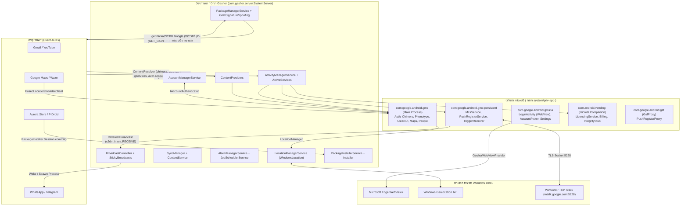
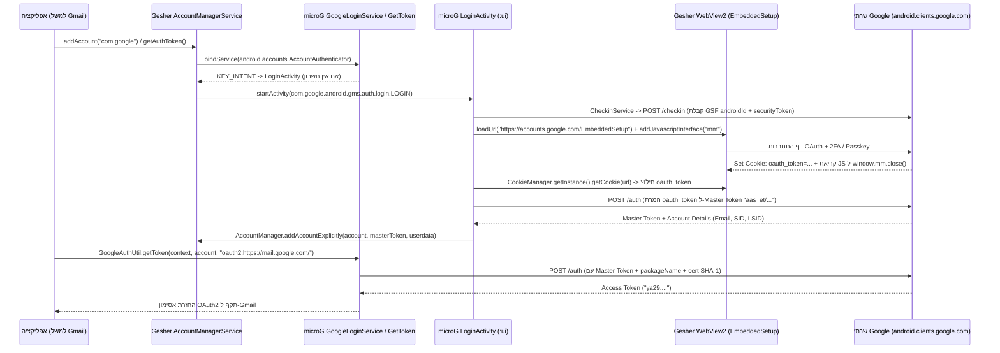

# הערכת היתכנות וארכיטקטורה להרצת microG על סביבת הריצה Gesher

## תקציר מנהלים והמלצה ארכיטקטונית

סביבת הריצה [Gesher](https://github.com/gesher-runtime/gesher) מריצה יישומי Android אמיתיים (קבצי APK) כתהליכי Windows תקניים על גבי מנוע הריצה ART ושלד AOSP מלא (`framework.jar` המבוסס על `android-16.0.0_r4`), תוך תרגום קריאות Bionic ל-Win32, האצת גרפיקה באמצעות `HWUI` / `Skia` / `ANGLE` על גבי Direct3D 11, ותרגום בינארי מ-ARM64 ל-x64. נכון לגרסה הנוכחית (`v0.1.0`), יישומים התלויים בשירותי Google Play (`com.google.android.gms` – להלן GMS) נתקלים בכשלים חוזרים ונשנים בעת הפעלתם על Gesher. על אף ש-Gesher כולל כיום שכבת דמה סינתטית בסיסית במחלקות [`GmsPackageSupport.java`](https://github.com/gesher-runtime/gesher/blob/main/app/java/com/gesher/server/GmsPackageSupport.java) ו-[`GmsService.java`](https://github.com/gesher-runtime/gesher/blob/main/app/java/com/gesher/server/GmsService.java), שכבה זו מסתפקת בהחזרת מידע חבילה סינתטי (`PackageInfo`) ובהכשלה מהירה (Fail-fast) של בקשות קישור לשירותים (`bindService` מחזיר `null` במחלקה [`ActiveServices.java`](https://github.com/gesher-runtime/gesher/blob/main/app/java/com/gesher/server/ActiveServices.java)). כתוצאה מכך, יישומי ליבה כגון Gmail, Google Maps, Waze, YouTube ו-WhatsApp נכשלים בשל היעדר ספקי תוכן חיוניים (`com.google.android.gms.chimera` ו-`com.google.android.gms.auth.accounts`), חוסר יכולת להתחבר לשירותי אימות ותצורה (`GoogleAuth.API`, `Phenotype.API`, `ClearcutLoggerSampling.API`), כישלון בהנפקת אסימוני דחיפה (`FirebaseInstanceId: SERVICE_NOT_AVAILABLE`), והצגת תיבות דו-שיח חוסמות למשתמש (`ConnectionResult{statusCode=API_UNAVAILABLE}` או קוד שגיאה 16 בעת פתיחת חלון כתיבת הודעה ב-Gmail).

דוח מחקר זה בוחן לעומק את ההיתכנות, הארכיטקטורה, השלכות האבטחה, הרישוי ותוכנית העבודה ההנדסית לשילוב [microG](https://microg.org/) — מימוש הקוד הפתוח (FLOSS) ברישיון Apache-2.0 לשירותי Google Play — בתוך סביבת הריצה Gesher. הניתוח מבוסס על סקירה ישירה של קוד המקור ותיעוד הארכיטקטורה של [Gesher](https://github.com/gesher-runtime/gesher) מול קוד המקור, המניפסטים והגרסאות של [microG GmsCore](https://github.com/microg/GmsCore), [GsfProxy](https://github.com/microg/GsfProxy) ורכיב החנות המלווה (`vending-app` / [FakeStore](https://github.com/microg/FakeStore)).

**המלצה מרכזית:** מומלץ לאמץ **אסטרטגיית שילוב היברידית ומדורגת של microG כתוסף מערכת אופציונלי (Optional System Add-on)** המותקן תחת `$ANDROID_ROOT/system/priv-app`, בשילוב מנגנון **זיוף חתימה מוגבל וממוקד (Scoped Signature Spoofing)** האכוף ברמת [`PackageManagerService.java`](https://github.com/gesher-runtime/gesher/blob/main/app/java/com/gesher/server/PackageManagerService.java) ומוגן מאחורי הגדרת מערכת מפורשת. גישה זו פותרת באופן מלא את בעיות הרישוי והפצת קוד צד-שלישי, שומרת על מודל אבטחה הדוק הזהה למודל העדכני של [LineageOS](https://review.lineageos.org/c/LineageOS/android_frameworks_base/+/413100/1) ו-[CalyxOS](https://gitlab.com/CalyxOS/calyxos/-/issues/2443), ומאפשרת הפעלה תקינה של אימות חשבונות Google (באמצעות מימוש ה-WebView2 הקיים ב-Gesher), ספקי התוכן של Chimera/Phenotype, שירותי מיקום ומיפוי, והודעות דחיפה (FCM/GCM) עבור רוב המכריע של היישומים הנפוצים. לצד זאת, עבור התקנת יישומים מתוך קטלוג Google Play, מומלץ לשלב את [Aurora Store](https://gitlab.com/AuroraOSS/AuroraStore) כלקוח הורדה העובד ישירות מול [`PackageInstallerService.java`](https://github.com/gesher-runtime/gesher/blob/main/app/java/com/gesher/server/PackageInstallerService.java) של Gesher, לצד `vending-app` (Companion/FakeStore) של microG המעניק תמיכה באימות רישיונות (`CHECK_LICENSE`) ורכישות פנימיות, במקום ניסיון להריץ את אפליקציית Google Play Store המקורית (`Phonesky`) הסובלת ממגבלות תאימות וחסימות אימות קשות.




## 1. ארכיטקטורת microG ומיפוי תאימות מול קוד השרת של Gesher

חבילת התוכנה של [microG](https://microg.org/) אינה ספרייה בודדת אלא מערכת אקולוגית מודולרית של יישומי מערכת ושירותי רקע המתחזים לחבילות הקנייניות של Google ומממשים מחדש את פרוטוקולי ה-IPC (ממשקי ה-AIDL, ה-Binder וה-ContentProvider) המצופים על ידי ספריית הלקוח `play-services-*` המוטמעת בתוך מיליוני יישומי Android. כדי להבין מדוע יישומים כגון Gmail קורסים או מציגים שגיאות על [Gesher](https://github.com/gesher-runtime/gesher) כיום, יש לפרק את ארכיטקטורת microG לתת-הרכיבים שלה ולבחון כל אחד מהם מול מימוש השרת של Gesher תחת [`app/java/com/gesher/server/`](https://github.com/gesher-runtime/gesher/tree/main/app/java/com/gesher/server).

### 1.1 פירוק רכיבי הליבה של microG

בגרסאות העדכניות של [microG GmsCore](https://github.com/microg/GmsCore) (כגון סדרת `v0.3.16.252432` ו-[`v0.3.17.252432`](https://github.com/microg/GmsCore/releases) המבוססת על גרסת בסיס GMS `25.24.32`, כפי שמוגדר ב-[`build.gradle`](https://github.com/microg/GmsCore/blob/master/build.gradle)), הפרויקט בנוי מרבדים המגדירים 74 תת-מודולים בקובץ [`settings.gradle`](https://github.com/microg/GmsCore/blob/master/settings.gradle) ומתגבשים לשלוש חבילות APK מרכזיות (בנוסף לרכיבי מיקום משלימים):

1. **ליבת השירותים – GmsCore (`com.google.android.gms`):**
   זוהי החבילה המרכזית המאגדת את המודולים תחת [`play-services-core/src/main/AndroidManifest.xml`](https://github.com/microg/GmsCore/blob/master/play-services-core/src/main/AndroidManifest.xml). ניתוח סטטי של המניפסט של `play-services-core` מעלה כי החבילה מגדירה **21 הרשאות מערכת ייעודיות (`<permission>`)**, מבקשת **37 הרשאות שימוש (`<uses-permission>`)** (בהן הרשאות פריבילגיות כגון `CHANGE_DEVICE_IDLE_TEMP_WHITELIST`, `UPDATE_APP_OPS_STATS`, `FAKE_PACKAGE_SIGNATURE` ו-`INSTALL_LOCATION_PROVIDER`), וכוללת **8 ספקי תוכן (`<provider>`)**, **70 שירותים (`<service>`)**, **10 מקלטי שידור (`<receiver>`)**, ו-**46 פעילויות ממשק משתמש (`<activity>`)**. החבילה מחלקת את רכיביה בין שלושה תהליכי ריצה:
   * **תהליך ברירת המחדל (`com.google.android.gms`):** מריץ את שירותי ה-API היומיומיים אליהם נקשרים יישומים דרך `IGmsServiceBroker` (כגון `ClearcutLoggerService`, `PhenotypeService`, `PeopleService`, `SignInService`, `AuthProxyService`, `CredentialsService`, `GamesService`, `MeasurementService`), וכן את שמונת ספקי התוכן הקריטיים.
   * **תהליך הרקע המתמיד (`com.google.android.gms:persistent`):** מריץ את תשתית ההודעות והדחיפה (`McsService`, `PushRegisterService`, `GcmInGmsService`, `TriggerReceiver`, `PushRegisterReceiver`, `SendReceiver`), וכן מקלטי דחיפה ייעודיים עבור אימות דו-שלבי (`org.microg.gms.auth.gcm.GcmReceiverService`) ואיכון מכשיר (`org.microg.gms.findmydevice.gcm.GcmReceiverService`).
   * **תהליך ממשק המשתמש (`com.google.android.gms:ui`):** מריץ את כלל המסכים והדיאלוגים האינטראקטיביים, לרבות מסך ההתחברות לחשבון Google מבוסס ה-WebView (`org.microg.gms.auth.login.LoginActivity`), בורר החשבונות (`org.microg.tools.AccountPickerActivity`), מסכי הרשאות גישה (`AskPermissionActivity`), מסכי FIDO/Passkeys (`IdentityFidoProxyActivity`, `PublicKeyProxyActivity`), ומסך ההגדרות והבדיקה העצמית של microG (`MainSettingsActivity`, `SelfCheckFragment$AsActivity`).

2. **מתאם מסגרת השירותים ההיסטורית – GsfProxy (`com.google.android.gsf`):**
   חבילה קטנה ממחלקת המאגר [microg/GsfProxy](https://github.com/microg/GsfProxy) המספקת תאימות לאחור עבור יישומים שעדיין פונים לחבילת Google Services Framework (`com.google.android.gsf`) לשם רישום C2DM/GCM ישן דרך השירות `org.microg.gms.gcm.PushRegisterProxy` (המאזין לפעולות `com.google.android.c2dm.intent.REGISTER` ו-`UNREGISTER`). חשוב לשים לב כי ספק התוכן הקריטי `com.google.android.gsf.gservices` (`GServicesProvider`), שממנו יישומים קוראים את מזהה המכשיר (`android_id` / GSF ID) ואת דגלי התצורה הבסיסיים, **כבר מוטמע ישירות בתוך `GmsCore`** תחת `org.microg.gms.gservices.GServicesProvider`, אך חלק מהיישומים בודקים מפורשות את קיומה של החבילה `com.google.android.gsf` ב-PackageManager או דורשים את הדגל `android:forceQueryable="true"` במניפסט שלה (כפי שתועד ב-[GsfProxy Issue #17](https://github.com/microg/GsfProxy/issues/17)).

3. **חנות מלווה – microG Companion / FakeStore (`com.android.vending`):**
   בעבר הופצה כיישום דמה ריק ממאגר [microg/FakeStore](https://github.com/microg/FakeStore) שהכיל הצהרת חבילה וחתימה מזויפת בלבד. כיום, המאגר הועבר לתוך תת-הפרויקט [`vending-app`](https://github.com/microg/GmsCore/blob/master/settings.gradle) בתוך מאגר `GmsCore` ומופץ תחת השם **microG Companion** (למשל `com.android.vending-84022634.apk` בגרסה `v0.3.17.252432`, המדמה את גרסת Play Store `40.2.26` עם קוד גרסה `84022634`). ניתוח המניפסט של `vending-app` מראה כי הוא כבר אינו ריק כלל: הוא מממש את שירות אימות הרישיונות `com.android.vending.licensing.LicensingService` (עבור יישומים הבודקים `CHECK_LICENSE`), את שירות הרכישות `PurchaseActivity` (`com.android.vending.BILLING`), את שירותי `GetInstallReferrerService`, `InAppReviewService`, ושירותי מעטפת ל-Play Integrity (`IntegrityService` ו-`ExpressIntegrityService`), לצד הורדת פיצולי נכסים (Play Asset Delivery) והפניית קישורי `market://` (`MarketIntentRedirect`).

4. **תשתית המיקום הרשתית – UnifiedNlp וספקי המיקום המובנים ב-GmsCore:**
   המאגר הנפרד [microg/UnifiedNlp](https://github.com/microg/UnifiedNlp) שימש בעבר כספק מיקום רשתי עצמאי המבוסס על תוספים (Backends). החל מגרסאות `v0.2.28` ו-`v0.3.x` של `GmsCore`, תשתית המיקום אוחדה במלואה לתוך תת-המודולים `play-services-location:core:provider` ו-`play-services-location:core:base` בתוך `GmsCore` עצמו (כפי שמתועד ב-[GmsCore Issue #1944](https://github.com/microg/GmsCore/issues/1944)). המניפסט של מודול המיקום ב-`GmsCore` חושף את `FusedLocationProviderService`, `NetworkLocationProviderService` (עבור `com.android.location.service.v3.NetworkLocationProvider`), ו-`GeocodeProviderService` (עבור המרת קואורדינטות לכתובות – Geocoding).

### 1.2 פענוח שגיאות הלוג האופייניות ב-Gesher מול רכיבי microG

השגיאות שנצפו בלוגים של Gesher בעת הרצת Gmail ויישומי Google אחרים משקפות באופן ישיר את הפער בין השכבה הסינתטית הקיימת ב-Gesher לבין המימוש של microG:

* **`Failed to find provider info for com.google.android.gms.chimera`:**
  ספריות Google Play Services המודרניות משתמשות במנגנון טעינה דינמית של מודולים הקרוי **Chimera** ו-**Dynamite** (`com.google.android.gms.dynamite.DynamiteModule`). כאשר אפליקציה (כגון Gmail או ספריית המפות/מודעות) מבקשת לטעון מודול דינמי, היא פונה תחילה דרך `ContentResolver.query()` אל ה-URI `content://com.google.android.gms.chimera/api/...`. ב-Gesher כיום, [`GmsPackageSupport.java`](https://github.com/gesher-runtime/gesher/blob/main/app/java/com/gesher/server/GmsPackageSupport.java) מייצר שירותים ומקלטי שידור סינתטיים, אך **אינו רושם אף `ContentProvider` סינתטי** ב-[`ContentProviders.java`](https://github.com/gesher-runtime/gesher/blob/main/app/java/com/gesher/server/ContentProviders.java). לעומת זאת, `GmsCore` רושם במניפסט שלו את `<provider android:name="org.microg.gms.chimera.ServiceProvider" android:authorities="com.google.android.gms.chimera" android:exported="true" />` ומספק את המחלקה [`DynamiteLoaderImpl.java`](https://github.com/microg/GmsCore/blob/master/play-services-core/src/main/java/com/google/android/gms/chimera/container/DynamiteLoaderImpl.java), העונה לשאילתות אלו ומחזירה את גרסאות המודולים המבוקשים.
* **`The com.google.android.gms.auth.accounts provider is not available`:**
  גרסאות עדכניות של ספריית האימות של Google (`play-services-auth-base`) אינן מסתפקות בקריאה ל-`AccountManager.getAccountsByType("com.google")` הרגיל של Android (שעלול להיות חסום עקב הגבלות נראות חשבונות ב-Android 8+), אלא פונות ישירות לספק התוכן `content://com.google.android.gms.auth.accounts` כדי לשלוף את רשימת חשבונות ה-Google המוגדרים במכשיר. ב-Gesher ספק זה אינו קיים, ולכן Gmail אינו מזהה חשבונות כלל. ב-`GmsCore`, הספק ממומש במלואו במחלקה `org.microg.gms.auth.AccountContentProvider` תחת הרשות `com.google.android.gms.auth.accounts`.
* **`unable to connect to service: com.google.android.gms.clearcut.service.START`:**
  כמעט כל אפליקציה של Google פותחת חיבור ל-Clearcut (שירות הטלמטריה והלוגים של Google) מיד עם עלייתה. ב-Gesher, הקריאה ל-`bindService` עבור `com.google.android.gms` נחתכת מיד ב-[`ActiveServices.java`](https://github.com/gesher-runtime/gesher/blob/main/app/java/com/gesher/server/ActiveServices.java) (שמחזיר `null` עבור חבילות סינתטיות). ב-`GmsCore`, השירות `org.microg.gms.clearcut.ClearcutLoggerService` מקבל את הקישור, מחזיר הצלחה מיידית (`Status.SUCCESS`) מבלי לשלוח נתוני מעקב לשרתי Google, ובכך מונע שגיאות וניסיונות חוזרים (Retries) שחונקים את ה-Main Thread או את תור ה-Worker של האפליקציה.
* **`ConnectionResult{statusCode=API_UNAVAILABLE}` עבור `GoogleAuth.API`, `Phenotype.API` ו-`ClearcutLoggerSampling.API` (והדיאלוג בקוד 16 בחלון ה-Compose של Gmail):**
  קוד השגיאה `16` ב-`ConnectionResult` הוא הקבוע `API_UNAVAILABLE`. כאשר Gmail פותח את חלון כתיבת ההודעה (`ComposeActivity`), הוא מאתחל את שירותי ההשלמה האוטומטית של אנשי קשר (`People.API` / `GoogleAuth.API`) ואת דגלי התצורה (`Phenotype.API`). כאשר `GoogleApiClient` או `GoogleApi` מנסים להיקשר לשירותים אלה ומקבלים דחייה או `API_UNAVAILABLE`, ספריית `GooglePlayServicesUtil` מקפיצה דיאלוג שגיאה מודאלי למשתמש ("בעיה בשירותי Google Play"). ב-`GmsCore`, שירותי `AuthProxyService`, `PhenotypeService` (יחד עם ספק התוכן `com.google.android.gms.phenotype`), ו-`PeopleService` ממומשים ומחזירים תשובות תקניות.
* **`FirebaseInstanceId: Token retrieval failed: SERVICE_NOT_AVAILABLE`:**
  בעת בקשת אסימון FCM/IID, האפליקציה שולחת Intent לשירות `com.google.android.c2dm.intent.REGISTER` (ב-`GmsCore`) או פונה ל-`PushRegisterReceiver` (`com.google.iid.TOKEN_REQUEST`). ב-Gesher, למרות שקיימות הגדרות קבועים ב-[`GmsService.java`](https://github.com/gesher-runtime/gesher/blob/main/app/java/com/gesher/server/GmsService.java), אין תהליך שמאזין ל-Intent הרישום, מבצע Check-in מול Google ומחזיר אסימון תקף. ב-`GmsCore`, השירות `org.microg.gms.gcm.PushRegisterService` בתהליך `:persistent` מטפל בבקשה ומנפיק אסימון FCM אמיתי.

### 1.3 מיפוי מפורט מול קוד השרת של Gesher (`app/java/com/gesher/server/`)

סקירה מעמיקה של 59 המחלקות בתיקיית [`app/java/com/gesher/server/`](https://github.com/gesher-runtime/gesher/tree/main/app/java/com/gesher/server) חושפת כי תשתית הליבה של Gesher בשלה ומפותחת באופן מרשים, וכוללת רבות מהיכולות ש-microG זקוק להן, לצד מספר נקודות חיכוך ספציפיות שיש לפתור:

1. **ניהול חבילות ורישום מערכת (`PackageManagerService.java`, `ApkPackage.java`, `SystemServer.java`, `Installer.java`):**
   * **מה קיים ב-Gesher:** המחלקה [`ApkPackage.java`](https://github.com/gesher-runtime/gesher/blob/main/app/java/com/gesher/server/ApkPackage.java) מפענחת קבצי APK באמצעות `PackageParser2` ו-`PackageInfoCommonUtils.generate` מתוך AOSP (`android-16.0.0_r4`), ומחלצת את כל רכיבי המניפסט (`activities`, `services`, `receivers`, `providers`, `requestedPermissions`, `sharedLibraries`). ב-[`PackageManagerService.java`](https://github.com/gesher-runtime/gesher/blob/main/app/java/com/gesher/server/PackageManagerService.java), המתודות `getPackageInfo` ו-`getApplicationInfo` בודקות **תחילה** את המפה `mPackages` (דרך `get(packageName)`), ורק אם החבילה אינה מותקנת (`p == null`), הן נופלות חזרה ל-`GmsPackageSupport.createSyntheticPackageInfo`.
   * **הפערים הקיימים:**
     * ראשית, [`SystemServer.java`](https://github.com/gesher-runtime/gesher/blob/main/app/java/com/gesher/server/SystemServer.java) טוען בעת האתחול רק חבילות שהועברו אליו כארגומנטים בשורת הפקודה או חבילות שנרשמו ב-`data/system/packages.list` דרך [`Installer.loadInstalled()`](https://github.com/gesher-runtime/gesher/blob/main/app/java/com/gesher/server/Installer.java). הוא **אינו סורק אוטומטית** את התיקיות `$ANDROID_ROOT/priv-app` או `$ANDROID_ROOT/app`.
     * שנית, ב-[`ActiveServices.java`](https://github.com/gesher-runtime/gesher/blob/main/app/java/com/gesher/server/ActiveServices.java) קיימת בדיקה קשיחה: `if (info != null && GmsPackageSupport.isSyntheticPackage(info.packageName)) return null;`. מכיוון ש-`GmsPackageSupport.isSyntheticPackage` מחזיר `true` תמיד עבור `"com.google.android.gms"` ו-`"com.android.vending"`, **גם אם נתקין את ה-APK האמיתי של microG GmsCore, המחלקה `ActiveServices` תחסום כל קריאת `bindService` אליו!** זהו ממצא קריטי בקוד של Gesher: חובה לעדכן את התנאי ב-`ActiveServices.java` כך שיחזיר `null` רק כאשר החבילה אינה מותקנת בפועל ב-`mPm.get(info.packageName)`.
     * שלישית, `ApkPackage` אינו אוסף תעודות חתימה אמיתיות מתוך קובץ ה-APK (`Certificates are not collected`), ולכן כאשר אפליקציה קוראת ל-`getPackageInfo("com.google.android.gms", GET_SIGNATURES)` על APK מותקן של microG, השדה `pi.signatures` עלול לחזור ריק (`null`) אלא אם כן נשלב את הוק ה-Signature Spoofing.

2. **ספקי תוכן חוצי-תהליכים (`ContentProviders.java`):**
   * **מה קיים ב-Gesher:** המחלקה [`ContentProviders.java`](https://github.com/gesher-runtime/gesher/blob/main/app/java/com/gesher/server/ContentProviders.java) תומכת באופן מלא בספקי תוכן מרובי-תהליכים! כאשר תהליך אפליקציה עולה, הוא מפרסם את ה-Providers שלו ב-`bindApplication` דרך `publishContentProviders()`. כאשר תהליך אחר קורא ל-`getContentProvider()` עבור רשות (Authority) השייכת לחבילה אחרת (כגון `com.google.android.gms.chimera` או `com.google.android.gms.auth.accounts`), אם תהליך היעד אינו רץ, `ContentProviders` קורא ל-`ActivityTaskManagerService.withProcess()` כדי להקים תהליך OS חדש עבור החבילה המארחת וממתין עד `PUBLISH_TIMEOUT_MS = 120_000` מילישניות עד שהספק מתפרסם, ואז מחזיר `ContentProviderHolder` עם ידית ה-Binder (`IContentProvider`).
   * **משמעות עבור microG:** כל 8 ספקי התוכן של `GmsCore` (`com.google.android.gsf.gservices`, `com.google.settings`, `subscribedfeeds`, `com.google.android.gms.fileprovider`, `com.google.android.gms.auth.accounts`, `com.google.android.gms.chimera`, `com.google.android.gms.fonts`, `com.google.android.gms.phenotype`) יעבדו באופן שקוף ומלא על גבי מימוש `ContentProviders.java` של Gesher ברגע ש-`GmsCore` יותקן כחבילה אמיתית!

3. **ניהול תהליכים, שירותים מרובי-תהליכים ומקלטי שידור (`ActivityManagerService.java`, `ActiveServices.java`, `BroadcastController.java`):**
   * **מה קיים ב-Gesher:** על פי ADR `0024-services-app-process.md` ו-ADR `0025-services-app-components.md`, כאשר מתבצעת קריאה ל-`startService` או `bindService` ב-`ActiveServices.java`, או שליחת שידור ב-`BroadcastController.java` (לרבות מקלטים סטטיים במניפסט), אם תהליך היעד אינו פעיל, Gesher מקים תהליך Windows חדש (`dalvikvm.exe` עם `com.gesher.app.Main` / `GesherAppProcess`) עבור החבילה המבוקשת. כמו כן, `SystemServer` משדר `Intent.ACTION_BOOT_COMPLETED` בעת עלייתו, מה שמפעיל את `TriggerReceiver` של microG (עבור Check-in ו-GCM).
   * **הפער הקיים:** ב-`GmsCore`, רכיבים מסוימים מוגדרים במניפסט תחת `android:process=":persistent"` ו-`android:process=":ui"`. יש לוודא כי מנהל התהליכים ב-`ActivityTaskManagerService` ו-`ActiveServices` מתמודד היטב עם מספר תת-תהליכים תחת אותו `packageName` (או מאחד אותם לתהליך החבילה של `com.google.android.gms` ללא התנגשות נעילות SQLite), וכי תהליך ה-`SystemServer` עצמו נשאר חי כל עוד סביבת Gesher פעילה (בהתאם ל-ADR `0026-services-persistent-device.md` ו-ADR `0046-services-own-server-closes-system-services.md`).

4. **חשבונות וסנכרון (`AccountManagerService.java`, `SyncManager.java`, `ContentService.java`):**
   * **מה קיים ב-Gesher:** [`AccountManagerService.java`](https://github.com/gesher-runtime/gesher/blob/main/app/java/com/gesher/server/AccountManagerService.java) סורק את המניפסטים של החבילות המותקנות לחיפוש שירותים עם הפעולה `android.accounts.AccountAuthenticator` ומטא-דאטה `android.accounts.AccountAuthenticator`, נקשר אליהם ב-Binder (`IAccountAuthenticator`), ומנהל חשבונות, נתוני משתמש (`UserData`) ואסימונים (`AuthTokens`) בזיכרון ועל הדיסק. [`SyncManager.java`](https://github.com/gesher-runtime/gesher/blob/main/app/java/com/gesher/server/SyncManager.java) מזהה מתאמי סנכרון (`android.content.SyncAdapter`) ומתזמן סנכרון מולם.

5. **ספריות משותפות (`SharedLibraryRegistry.java`, `SharedLibraryGraph.java`):**
   * **מה קיים ב-Gesher:** [`SharedLibraryRegistry.java`](https://github.com/gesher-runtime/gesher/blob/main/app/java/com/gesher/server/SharedLibraryRegistry.java) רושם ספריות משותפות של המערכת (כגון `org.apache.http.legacy`) ופותח תלויות `<uses-library>` בעת טעינת חבילות.
   * **הפער הקיים:** עבור יישומים ישנים מאוד המשתמשים ב-Google Maps API v1 (`<uses-library android:name="com.google.android.maps" />`), ניתן לרשום את קובץ ה-JAR הקטן של MapsV1 מבית microG בתוך `SharedLibraryRegistry`. יישומים מודרניים (המשתמשים ב-Maps SDK v2) אינם זקוקים ל-`<uses-library>` אלא טוענים את המפה דרך Dynamite/Chimera או ישירות מול שירותי ה-AIDL של `GmsCore`.

### 1.4 מטריצת תאימות מפורטת (רכיב מול תמיכת Gesher, פערים ומאמץ הנדסי)

הטבלה הבאה מרכזת את כלל רכיבי microG, דרישותיהם מהפלטפורמה, המצב הקיים בקוד של Gesher, הפערים שזוהו והערכת המאמץ להשלמתם (בקנה מידה: **S** = שינוי נקודתי של עשרות שורות קוד / ימים בודדים; **M** = פיתוח והתאמה של תת-מערכת בהיקף בינוני / 1–2 שבועות; **L** = שינוי ארכיטקטוני רחב / מספר שבועות):

| רכיב ב-microG | חבילה / מחלקה ב-microG | דרישות מהפלטפורמה (AOSP / Gesher) | מצב קיים ב-Gesher (קובץ ומחלקה) | פערים להשלמה ב-Gesher | הערכת מאמץ |
| :--- | :--- | :--- | :--- | :--- | :--- |
| **זיוף חתימה (Signature Spoofing)** | `com.google.android.gms`, `com.android.vending` (`fake-signature`) | הוק ב-`getPackageInfo` המחזיר את חתימת Google (`38918a45...`) עבור `GET_SIGNATURES` ו-`GET_SIGNING_CERTIFICATES` לחבילות מורשות, והרשאת `FAKE_PACKAGE_SIGNATURE` | קיים קבוע `GOOGLE_CERT_HEX` ויצירת `SigningInfo` סינתטי ב-[`GmsPackageSupport.java`](https://github.com/gesher-runtime/gesher/blob/main/app/java/com/gesher/server/GmsPackageSupport.java), אך מופעל **רק** כש-GmsCore אינו מותקן | הוספת הוק ב-`PackageManagerService.getPackageInfo` שמזריק את `getGoogleSignature()` גם ל-`ApkPackage` מותקן של microG כשהדגל מופעל | **S** |
| **קישור שירותי GMS (`IGmsServiceBroker`)** | `GmsCore` (70 שירותי `START` / `BIND`) | תמיכה ב-`bindService` ו-`startService` חוצי-תהליכים וריצה תחת UID של `com.google.android.gms` | קיים מימוש מלא ב-[`ActiveServices.java`](https://github.com/gesher-runtime/gesher/blob/main/app/java/com/gesher/server/ActiveServices.java), אך שורה 114 מחזירה `null` באופן קשיח לכל חבילה שבה `isSyntheticPackage` אמת | שינוי הבדיקה ב-`ActiveServices.java` כך שתחסום קישור רק אם `mPm.get(info.packageName) == null` | **S** |
| **ספקי תוכן (`chimera`, `gservices`, `phenotype`, `fonts`, `auth.accounts`)** | `ServiceProvider`, `GServicesProvider`, `ConfigurationProvider`, `FontsProvider`, `AccountContentProvider` | פרסום ספקי תוכן מרובי-תהליכים, הקמת תהליך יעד בעת קריאת `getContentProvider`, והעברת `IContentProvider` ב-Binder | **נתמך במלואו** ב-[`ContentProviders.java`](https://github.com/gesher-runtime/gesher/blob/main/app/java/com/gesher/server/ContentProviders.java) (כולל הקמת תהליך אוטומטית והמתנה עד 120 שניות) | אין פער פונקציונלי; דורש רק התקנת ה-APK של `GmsCore` וטעינתו ב-`SystemServer` | **S** |
| **מאמת חשבונות Google (`AccountAuthenticator`)** | `GoogleLoginService`, `WorkAccountAuthenticatorService`, `LoginActivity` | גילוי שירותי `AccountAuthenticator`, אחסון חשבונות ואסימונים, ורכיב `WebView` התומך ב-`addJavascriptInterface("mm")` וב-`CookieManager` | **נתמך ברובו** ב-[`AccountManagerService.java`](https://github.com/gesher-runtime/gesher/blob/main/app/java/com/gesher/server/AccountManagerService.java) וב-WebView2 ([`docs/webview.md`](https://github.com/gesher-runtime/gesher/blob/main/docs/webview.md)) | וידוא סנכרון מיידי של עוגיית `oauth_token` מ-`ICoreWebView2CookieManager` ב-`GesherCookieManager` והזרקת ה-User-Agent התואם | **S–M** |
| **רישום מכשיר (Device Check-in)** | `CheckinService`, `TriggerReceiver` (`android.server.checkin.CHECKIN`) | שידור `BOOT_COMPLETED`, גישה לאינטרנט (HTTPS), כתיבה ל-`GServicesProvider`, וקריאת מאפייני מכשיר מ-`android.os.Build` | שידור `BOOT_COMPLETED` ורשת קיימים ב-[`BroadcastController.java`](https://github.com/gesher-runtime/gesher/blob/main/app/java/com/gesher/server/BroadcastController.java) ו-[`ConnectivityService.java`](https://github.com/gesher-runtime/gesher/blob/main/app/java/com/gesher/server/ConnectivityService.java) | וידוא שערכי `android.os.Build` (דגם, טביעת אצבע, ארכיטקטורה) ב-Gesher מכילים ערכי פרופיל Android תקינים שאינם נדחים על ידי שרת ה-Check-in של Google | **S** |
| **הודעות דחיפה (GCM / FCM)** | `McsService`, `PushRegisterService`, `GsfProxy` (תהליך `:persistent`) | חיבור TCP/TLS מתמיד ל-`mtalk.google.com:5228`, התראות תזמון (`AlarmManager`), והערת אפליקציות שאינן רצות באמצעות שידור `com.google.android.c2dm.intent.RECEIVE` | [`AlarmManagerService.java`](https://github.com/gesher-runtime/gesher/blob/main/app/java/com/gesher/server/AlarmManagerService.java) ו-[`BroadcastController.java`](https://github.com/gesher-runtime/gesher/blob/main/app/java/com/gesher/server/BroadcastController.java) תומכים בהקמת תהליכי יעד בעת שידור; אך תהליך השרת נסגר כשאין אפליקציה פתוחה (ADR `0046`) | הוספת מצב Daemon אופציונלי במגש המערכת של Windows (System Tray) אם נדרשת קבלת התראות Push גם כשכל חלונות האפליקציות סגורים | **M** |
| **שירותי מיקום (`FusedLocation` / `Geocode`)** | `FusedLocationProviderService`, `NetworkLocationProviderService`, `GeocodeProviderService` | חיבור ל-`LocationManagerService` של הפלטפורמה וקבלת קואורדינטות מהמערכת המארחת | [`LocationManagerService.java`](https://github.com/gesher-runtime/gesher/blob/main/app/java/com/gesher/server/LocationManagerService.java) ו-[`WindowsLocation.java`](https://github.com/gesher-runtime/gesher/blob/main/app/java/com/gesher/server/WindowsLocation.java) מחברים ישירות את `gps`/`network`/`fused` ל-Windows Geolocation API! | `GmsCore` יקבל מיקום ישירות מ-`LocationManager` של Gesher (המבוסס על WindowsLocation); יש רק לוודא מתן הרשאות מיקום ל-`GmsCore` | **S** |
| **מפות (`play-services-maps`)** | `Mapbox` / `VTM` (OpenGL ES) בתוך `GmsCore` | רינדור OpenGL ES 2.0/3.0 בתוך `SurfaceView` / `TextureView`, טעינת ספריות נייטיביות (`.so`) של Mapbox/VTM, ותמיכה ב-Child Surfaces | **נתמך** דרך שכבת `ANGLE` / Direct3D 11, תמיכה ב-Child Surfaces (ADR `0056`), ותרגום ARM64 ל-x64 (ADR `0047`) או טעינת `x86_64` | חילוץ תקין של ספריות ה-JNI מתוך `GmsCore.apk` (עדיפות ל-ABI `x86_64` אם קיים ב-APK האוניברסלי, או תרגום `arm64-v8a`) | **S–M** |
| **תאימות מערכת ובדיקות תקינות (SafetyNet / DroidGuard / Play Integrity stubs)** | `DroidGuard`, `SafetyNetClientService`, `IntegrityService` (ב-`vending-app`) | מענה לבקשות API של SafetyNet ו-Play Integrity מבלי לקרוס | לא קיים ב-Gesher | `GmsCore` ו-`vending-app` מספקים מעטפת שמחזירה תגובת שגיאה מבוקרת או אימות בסיסי (ללא זיוף חומרה/Keystore, בהתאם לאילוצי הפרויקט) | **S** |
| **חנות מלווה, רישוי ורכישות (`vending-app`)** | `com.android.vending` (`LicensingService`, `PurchaseActivity`, `InstallService`) | הרשאת `FAKE_PACKAGE_SIGNATURE`, `INSTALL_PACKAGES`, וקישור ל-`PackageInstallerService` | [`PackageInstallerService.java`](https://github.com/gesher-runtime/gesher/blob/main/app/java/com/gesher/server/PackageInstallerService.java) ו-[`Installer.java`](https://github.com/gesher-runtime/gesher/blob/main/app/java/com/gesher/server/Installer.java) מממשים התקנת Session מלאה | הוספת `com.android.vending` לרשימת החבילות המורשות ב-`GmsSignatureSpoofing` והסרת החסימה ב-`ActiveServices.java` | **S** |
| **FIDO / Passkeys ו-Credential Manager** | `Fido2ApiService`, `PasswordAndPasskeyService`, `GoogleIdService` | שירות מערכת `CredentialManager` (Android 14+), WebView / Bluetooth / USB או גישור ל-WebAuthn של Windows | שירות `credential` אינו רשום כיום ב-[`Services.java`](https://github.com/gesher-runtime/gesher/blob/main/app/java/com/gesher/server/Services.java) של Gesher | שירותי FIDO הישנים (דרך GMS Binder/Activity) יעבדו; תמיכה ב-Android 14 `CredentialManager` תדרוש רישום שירות `credential` ב-`Services.java` | **M** |
| **Nearby / Exposure Notifications / Cast / Wearable** | `ExposureNotificationService`, `CastService`, `WearableService` | Bluetooth Low Energy (BLE) scanning/advertising, mDNS / Multicast ברשת המקומית | רשת מקומית (`ConnectivityService`, sockets) קיימת (ADR `0037`, `0070`); גישור Bluetooth מלא ל-Windows אינו ממומש | Cast על גבי Wi-Fi/LAN יפעל דרך שקעי הרשת של Windows; רכיבי BLE (Exposure Notifications, Wearable, Nearby Share ב-BLE) לא יפעלו ללא גשר Bluetooth | **L** (עבור BLE) |


## 2. זיוף חתימה (Signature Spoofing): ארכיטקטורה, מימוש ב-Gesher וניתוח סיכוני אבטחה

### 2.1 מדוע microG זקוק לזיוף חתימה וכיצד Google בודקת חתימות

אחד מעמודי התווך של מודל האבטחה באקוסיסטם של Google על גבי Android הוא אימות זהות החבילה `com.google.android.gms` (וכן `com.android.vending` ו-`com.google.android.gsf`) באמצעות תעודת החתימה הקריפטוגרפית שלה. ספריית הלקוח `play-services-basement` (במחלקות `GooglePlayServicesUtilLight` ו-`GoogleSignatureVerifier`) משובצת בתוך כל אפליקציה שמשתמשת ב-GMS (כגון Gmail, Google Maps, Waze, WhatsApp). לפני שהאפליקציה מסכימה להיקשר לשירות Binder של GMS, לשלוח לו אסימוני OAuth או לטעון ממנו קוד דינמי דרך Chimera/Dynamite, היא קוראת ל-`PackageManager.getPackageInfo("com.google.android.gms", flags)` (עם הדגלים `PackageManager.GET_SIGNATURES = 0x40` או `PackageManager.GET_SIGNING_CERTIFICATES = 0x08000000` החל מ-Android 9 / API 28), או לקריאה `PackageManager.hasSigningCertificate(...)`, ומשווה את בית התעודה המוחזרת אל מול הגיבוב המוטמע בקוד הקשיח של הספרייה — תעודת החתימה הרשמית של Google (בעלת טביעת אצבע SHA-1: `38:91:8A:45:3D:07:19:93:54:F8:B1:9A:F0:5E:C6:56:2C:ED:57:88`).

כפי שמתועד ב-[תיעוד Signature Spoofing הרשמי של microG](https://github.com/microg/GmsCore/wiki/Signature-Spoofing), מכיוון שפרויקט microG אינו מחזיק במפתח הפרטי של Google, קובצי ה-APK הרשמיים של microG נחתמים במפתח של צוות microG (`O=NOGAPPS Project, C=DE`, בעל טביעת אצבע SHA-256: `9bd06727e62796c0130eb6dab39b73157451582cbd138e86c468acc395d14165`). ללא התערבות של מערכת ההפעלה ב-`PackageManagerService`, כל אפליקציה הקוראת ל-`getPackageInfo("com.google.android.gms", GET_SIGNATURES)` תקבל את תעודת החתימה של microG, תזהה אי-התאמה מול תעודת Google, תזרוק שגיאת `SERVICE_INVALID` (קוד 9 ב-`ConnectionResult`), ותסרב לפעול.

בנוסף, החל מנובמבר 2024 (כפי שצוין ב-[Wiki של microG](https://github.com/microg/GmsCore/wiki/Signature-Spoofing)), Google עדכנה את קוד בדיקת החתימות בגרסאות חדשות של ספריות הלקוח ואפליקציות Google כך שהן בודקות לא רק את המערך הישן `PackageInfo.signatures` אלא גם את מבנה ה-`SigningInfo` (`PackageInfo.signingInfo.getApkContentsSigners()` ו-`getSigningCertificateHistory()`), וכן קריאות ישירות ל-`checkSignatures` ו-`hasSigningCertificate`.

### 2.2 סקירת האפשרויות והמודלים לזיוף חתימה

קיימות ארבע גישות עיקריות להתמודדות עם דרישת החתימה של microG:

1. **מודל הרשאת `FAKE_PACKAGE_SIGNATURE` הקלאסי (הפאץ' המסורתי של microG / OmniROM / crDroid):**
   הפאץ' המקורי לעץ `frameworks/base` (כפי שמופיע ב-[פאץ' ה-Signature Spoofing ל-AOSP](https://gitea.angry.im/iovxw/patches/src/branch/aosp13/frameworks/base/0002-Add-support-for-app-signature-spoofing.patch)) מוסיף הרשאת מערכת חדשה בשם `android.permission.FAKE_PACKAGE_SIGNATURE` (ברמת הגנה `dangerous` או `signature|privileged`). אם אפליקציה מחזיקה בהרשאה זו ומגדירה במניפסט שלה `<meta-data android:name="fake-signature" android:value="..." />` (כפי שמוגדר במודול [`fake-signature/src/main/AndroidManifest.xml`](https://github.com/microg/GmsCore/blob/master/fake-signature/src/main/AndroidManifest.xml) של `GmsCore`), הפונקציה שמייצרת את `PackageInfo` מחליפה את `pi.signatures` ו-`pi.signingInfo` במחרוזת ההקסדצימלית מתוך `fake-signature`.
2. **מודל ההגבלה הקשיחה ל-microG בלבד (LineageOS 21+ / CalyxOS):**
   החל מפברואר 2024 ([LineageOS Gerrit 413100](https://review.lineageos.org/c/LineageOS/android_frameworks_base/+/413100/1)) וב-[CalyxOS Issue #2443](https://gitlab.com/CalyxOS/calyxos/-/issues/2443), מערכות הפעלה מובילות זנחו את המודל הפתוח שבו כל אפליקציה יכולה לבקש מהמשתמש הרשאת זיוף חתימה, ועברו למודל שבו זיוף החתימה מוגבל **אך ורק** לחבילות המוכרות של microG (`com.google.android.gms` ו-`com.android.vending`) ורק כאשר הן מותקנות כיישומי מערכת או חתומות במפתח המוכר של microG.
3. **רשימת היתר (Allowlist) ייעודית ב-Gesher מאחורי הגדרת מערכת:**
   מכיוון של-Gesher יש מימוש עצמאי וקומפקטי של [`PackageManagerService.java`](https://github.com/gesher-runtime/gesher/blob/main/app/java/com/gesher/server/PackageManagerService.java) (351 שורות קוד בלבד!) ושל [`GmsPackageSupport.java`](https://github.com/gesher-runtime/gesher/blob/main/app/java/com/gesher/server/GmsPackageSupport.java) שכבר מחזיק את הקבוע `GOOGLE_CERT_HEX` ואת המתודה `GmsPackageSupport.getGoogleSignature()`, אין כל צורך בפאץ' מסורבל ל-AOSP ` frameworks/base`. ניתן לממש מחלקה ייעודית ונקייה (`GmsSignatureSpoofing.java`) בתוך `com.gesher.server` הבודקת: (א) שדגל ההגדרה מופעל (`GESHER_MICROG_SPOOF=1` או הגדרה ב-`SettingsProvider`), (ב) ששם החבילה נמצא ברשימת ההיתר הקשיחה (`com.google.android.gms`, `com.android.vending`, `com.google.android.gsf`), ו-(ג) שהחבילה מבקשת `android.permission.FAKE_PACKAGE_SIGNATURE`.
4. **ללא זיוף חתימה כלל (מצב מנוון / `org.microg.gms-user.apk`):**
   פרויקט microG מפרסם בגרסאות ה-Release שלו קובץ בשם `org.microg.gms-252432034-user.apk` (במקביל ל-`com.google.android.gms`) או גרסאות ייעודיות עבור יישומים שעברו שכתוב שם חבילה (כגון ReVanced). ואולם, ללא זיוף חתימה וללא שם החבילה `com.google.android.gms`, **אף אפליקציה תקנית (לא Gmail, לא Maps, לא Waze ולא WhatsApp) לא תזהה את microG**, שכן כולן פונות בקוד קשיח לשם החבילה `com.google.android.gms` ובודקות את חתימת Google. לכן, מצב ללא זיוף חתימה אינו שמיש עבור מטרות Gesher.

### 2.3 המצב הקיים בקוד של Gesher ומיקום השינוי המדויק

בחינת הקוד הנוכחי של [`PackageManagerService.java`](https://github.com/gesher-runtime/gesher/blob/main/app/java/com/gesher/server/PackageManagerService.java) ו-[`ApkPackage.java`](https://github.com/gesher-runtime/gesher/blob/main/app/java/com/gesher/server/ApkPackage.java) ב-Gesher מגלה תופעה מעניינת מאוד:
* כאשר `com.google.android.gms` **אינו מותקן** כ-APK, הקריאה `PackageManagerService.getPackageInfo("com.google.android.gms", flags, userId)` רואה ש-`get(packageName)` מחזיר `null`, ולכן קוראת ל-`GmsPackageSupport.createSyntheticPackageInfo(packageName, flags)`. מתודה זו ב-`GmsPackageSupport.java` **כבר מזריקה את חתימת Google הרשמית (`getGoogleSignature()`)** לתוך `pi.signatures` ו-`pi.signingInfo`!
* לעומת זאת, ברגע שאנו מתקינים את קובץ ה-APK האמיתי של microG (`com.google.android.gms.apk`), המתודה `get("com.google.android.gms")` ב-`PackageManagerService.java` (שורה 58) מחזירה אובייקט `ApkPackage p` שאינו `null`, ומבצעת:
  ```java
  ApkPackage p = get(packageName);
  if (p != null) {
      return p.generatePackageInfo(flags);
  }
  ```
* בתוך `ApkPackage.generatePackageInfo(flags)`, מתבצעת קריאה ל-`PackageInfoCommonUtils.generate(parsed, flags, 0)`. מכיוון ש-`ApkPackage.parse` ב-Gesher מדלג על איסוף תעודות חתימה (`skipCertificates` ב-`PackageParser2`), האובייקט `PackageInfo` המוחזר עבור ה-APK המותקן של microG חוזר **ללא חתימת Google** (או עם שדה `signatures` ריק)!
* יתר על כן, ב-[`ActiveServices.java`](https://github.com/gesher-runtime/gesher/blob/main/app/java/com/gesher/server/ActiveServices.java) (שורה 114), הבדיקה:
  ```java
  if (info != null && GmsPackageSupport.isSyntheticPackage(info.packageName)) {
      return null;
  }
  ```
  מונעת קישור (`bindService`) ל-`com.google.android.gms` ול-`com.android.vending` אפילו כאשר הם מותקנים כ-`ApkPackage` אמיתי בתוך `mPackages`!

לפיכך, המיקומים המדויקים בקוד של Gesher שבהם יש לשלב את התמיכה הם:
1. **`app/java/com/gesher/server/GmsSignatureSpoofing.java` (קובץ חדש):** מחלקת עזר המממשת את בדיקת הדגל, רשימת ההיתר (`ALLOWED_PACKAGES`), בדיקת ההרשאה `FAKE_PACKAGE_SIGNATURE`, והזרקת החתימה מתוך `<meta-data android:name="fake-signature">` או מתוך `GmsPackageSupport.getGoogleSignature()` לתוך `pi.signatures` ו-`pi.signingInfo`.
2. **`app/java/com/gesher/server/PackageManagerService.java` (שורות 57–65 ומתודת `checkPermission`):**
   * ב-`getPackageInfo`: העברת ה-`PackageInfo` שנוצר על ידי `p.generatePackageInfo(flags)` דרך `GmsSignatureSpoofing.maybeSpoofPackageInfo(p, pi, flags, mMicrogSpoofingEnabled)`.
   * ב-`checkPermission`: אכיפה מפורשת שההרשאה `android.permission.FAKE_PACKAGE_SIGNATURE` תוחזר כ-`PERMISSION_GRANTED` אך ורק עבור חבילות ברשימת ההיתר של microG וכאשר הדגל מופעל, ו-`PERMISSION_DENIED` לכל חבילה אחרת (כדי שהבדיקה העצמית – Self-Check – של microG תזהה שההרשאה הוענקה כראוי, ומנגד שאף אפליקציה זדונית לא תקבל אותה).
3. **`app/java/com/gesher/server/ActiveServices.java` (שורה 114):** הוספת התנאי `&& mPm.get(info.packageName) == null` לפני החזרת `null`, כך שחסימת הקישור תחול רק על חבילת הדמה הסינתטית ולא כאשר microG מותקן בפועל.

### 2.4 ניתוח כנה ומעמיק של השלכות האבטחה והפחתת הסיכונים (Mitigations)

זיוף חתימה הוא מנגנון רגיש ביותר במערכת ההפעלה Android, שכן חתימת האפליקציה משמשת לשלוש מטרות אבטחה קריטיות:
1. **אימות זהות השרת ב-IPC:** אפליקציות לקוח מוודאות שהשירות שאליו התחברו (`com.google.android.gms`) הוא אכן שירות המערכת המורשה לפני שהן מוסרות לו אסימוני גישה או נתונים רגישים.
2. **הרשאות ברמת `signature` (`protectionLevel="signature"`):** ב-Android תקני, אם אפליקציה א' מגדירה הרשאה ברמת `signature`, כל אפליקציה ב' החתומה באותה תעודה יכולה לקבל הרשאה זו אוטומטית ולגשת לרכיבים פנימיים של אפליקציה א'.
3. **שיתוף UID (`android:sharedUserId`):** חבילות החולקות את אותה חתימה יכולות לחלוק מרחב תהליך ונתונים.

**הסיכונים אם זיוף חתימה ממומש באופן רשלני:**
* **התחזות של אפליקציה זדונית ל-GMS או לאפליקציה אחרת:** אם כל אפליקציה המותקנת על ידי המשתמש יכולה להצהיר במניפסט על `<meta-data android:name="fake-signature">` ולקבל את החתימה המבוקשת (כפי שקורה אם `PackageManagerService` מעניק את כל ההרשאות באופן גורף ללא סינון), אפליקציה זדונית תוכל להתחזות לכל אפליקציה של Google או של בנק, לגנוב הרשאות `signature`, או ליירט קריאות IPC.
* **עקיפת אימות חתימות כללי ב-`PackageManagerService`:** כפי שראינו בניתוח הקוד של Gesher, כיום מתודות כגון `checkSignatures` ב-`PackageManagerService` מחזירות `SIGNATURE_MATCH` כברירת מחדל מפני ש-Gesher אינו אוסף תעודות חתימה ב-`ApkPackage`. בעוד שזה מפשט הרצת אפליקציות בודדות, בסביבה מרובת אפליקציות הדבר עלול לאפשר לאפליקציה צד-שלישי לעבור בדיקות `checkSignatures` מול אפליקציה אחרת.

**הפחתת הסיכונים (Mitigations) במודל המוצע ל-Gesher:**
1. **רשימת היתר קשיחה לפי שם חבילה (`ALLOWED_PACKAGES`):** ב-`GmsSignatureSpoofing.java`, הזרקת החתימה מוגבלת בקוד קשיח לשלוש חבילות בלבד: `com.google.android.gms`, `com.android.vending`, ו-`com.google.android.gsf`. שום חבילה אחרת אינה יכולה לזייף חתימה גם אם תכלול את ההרשאה והמטא-דאטה במניפסט שלה.
2. **הגנה מפני החלפת חבילה (Package Squatting) באמצעות מיקום `priv-app` ואימות גיבוב תעודה:** כאשר microG מותקן מראש או על ידי מנהל המערכת תחת `$ANDROID_ROOT/system/priv-app`, אפליקציית משתמש רגילה אינה יכולה לדרוס את `com.google.android.gms`. יתרה מכך, המתודה `GmsSignatureSpoofing.isOfficialMicrogCertificate(byte[] certBytes)` מוודאת שגיבוב ה-SHA-256 של תעודת ה-APK המותקן תואם בדיוק למפתח החתימה הרשמי של פרויקט microG (`9bd06727e62796c0130eb6dab39b73157451582cbd138e86c468acc395d14165`).
3. **סירוב ברירת מחדל (`PERMISSION_DENIED`) עבור `FAKE_PACKAGE_SIGNATURE` לכל שאר החבילות:** ב-`PackageManagerService.checkPermission`, למרות ש-Gesher נוקט גישה מתירנית להרשאות זמן-ריצה רגילות (כגון מצלמה או רשת), עבור `android.permission.FAKE_PACKAGE_SIGNATURE` מוחזר `PERMISSION_DENIED` קשיח לכל חבילה שאינה ברשימת ההיתר או כאשר התכונה כבויה.
4. **מתג הפעלה מפורש (Opt-in Setting):** המנגנון כבוי כברירת מחדל ומופעל רק כאשר המשתמש או סקריפט האריזה מגדיר מפורשות `GESHER_MICROG_SPOOF=1` או את הגדרת המערכת `gesher_microg_signature_spoofing=1` ב-`SettingsProvider`.


## 3. חשבונות Google ואימות משתמשים (Accounts & Authentication)

היכולת להתחבר לחשבון Google ולהנפיק אסימוני OAuth2 עבור יישומים (כגון Gmail, YouTube, Google Maps ו-Drive) היא אחד הצרכים המרכזיים בגינם משתמשים מתקינים את microG. תהליך זה מערב ארבע שכבות שונות: רישום המכשיר (Check-in), תהליך ההתחברות האינטראקטיבי ב-WebView (`LoginActivity`), ניהול החשבון ב-`AccountManagerService`, והנפקת אסימונים לאפליקציות (`GoogleAuthUtil` ו-`AccountContentProvider`).



### 3.1 תהליך ההתחברות האינטראקטיבי ב-WebView מול WebView2 ב-Gesher

כאשר המשתמש מוסיף חשבון Google ב-microG, מופעלת הפעילות [`org.microg.gms.auth.login.LoginActivity`](https://github.com/microg/android_packages_apps_GmsCore/blob/master/play-services-core/src/main/java/org/microg/gms/auth/login/LoginActivity.java) הרצה בתהליך `:ui`. בניגוד להתחברות OAuth רגילה בדפדפן חיצוני, מערכת ההתחברות של Android משתמשת בכתובת הייעודית `https://accounts.google.com/EmbeddedSetup` בתוך רכיב `android.webkit.WebView` פנימי.

בחינת מימוש ה-WebView ב-Gesher (המתועד ב-[`docs/webview.md`](https://github.com/gesher-runtime/gesher/blob/main/docs/webview.md) וב-ADR `0041-webview-webview2.md` ו-ADR `0050-webview2-completeness.md`) מעלה התאמה גבוהה מאוד לדרישות של `LoginActivity`, לצד שלוש נקודות עדינות שיש לתת עליהן את הדעת:

1. **ממשק ה-JavaScript (`addJavascriptInterface` עבור האובייקט `mm` / MinuteMaid):**
   דף ה-`EmbeddedSetup` של Google מתקשר עם קוד ה-Java של `LoginActivity` באמצעות קריאות ל-`window.mm` (למשל `window.mm.getAccounts()`, `window.mm.getBuildVersionSdk()`, `window.mm.hasPhoneNumber()`, `window.mm.showKeyboard()`, ובעת סיום מוצלח `window.mm.close()`). ב-Gesher, המתודה `addJavascriptInterface` ממומשת ב-`GesherWebViewProvider` וב-`compat/webview/webview_host.cc` באמצעות אובייקט COM/IDispatch בשם `gesherBridge` וסקריפט המוזרק ב-`AddScriptToExecuteOnDocumentCreated` הקורא באופן סינכרוני ל-`chrome.webview.hostObjects.sync.gesherBridge.callJava(name, method, argsJson)`.
   * **מדוע זה יעבוד:** מכיוון ש-`AddScriptToExecuteOnDocumentCreated` רץ לפני כל סקריפט של הדף עצמו בכל ניווט (`NavigationStarting`), האובייקט `window.mm` יהיה זמין לסקריפטים של Google כבר בעת טעינת `EmbeddedSetup`, והקריאות הסינכרוניות יחזירו את ערכי ה-Primitive/String המצופים.
2. **חילוץ עוגיית `oauth_token` דרך `CookieManager` (`GesherCookieManager`):**
   כאשר המשתמש מסיים להזין את פרטי החשבון והאימות הדו-שלבי (2FA), שרתי Google שותלים עוגייה בשם `oauth_token` עבור הדומיין `accounts.google.com` ומבצעים ניווט סיום (`#close`). ברגע ש-`WebViewClient.onPageFinished` או `shouldOverrideUrlLoading` מזהה את סיום ההתחברות, `LoginActivity` קורא ל-`CookieManager.getInstance().getCookie(url)` כדי לשלוף את `oauth_token` ולהמיר אותו בבקשת POST אל `https://android.clients.google.com/auth` לאסימון ראשי (Master Token – שמתחיל ב-`aas_et/`).
   * **נקודת תורפה פוטנציאלית ב-WebView2:** ב-Microsoft Edge WebView2, ממשק ה-COM `ICoreWebView2CookieManager::GetCookies` הוא אסינכרוני מטבעו. ב-Gesher, המחלקה `GesherCookieManager` מגשרת בין `CookieManager.getCookie(String url)` הסינכרוני של Android לבין `ICoreWebView2CookieManager`. יש לוודא שכאשר `getCookie` נקרא מתוך ה-UI Thread (במהלך ה-Callback של `onPageFinished`), הגישור ל-WebView2 אינו גורם לקיפאון (Deadlock) של ה-UI Thread ההולך להמתין ל-Callback של ה-COM על אותו Thread, וכן שעוגיות המסומנות כ-`HttpOnly` מוחזרות במלואן מ-`ICoreWebView2CookieManager` (אשר בניגוד ל-`document.cookie` ב-JS, אכן חושף עוגיות `HttpOnly` לקוד המארח ב-C++).
3. **מחרוזת ה-User-Agent וזיהוי הדפדפן:**
   שרתי `EmbeddedSetup` של Google בודקים שבקשת ה-WebView מגיעה מתוך WebView של Android (מחרוזת User-Agent הכוללת `; wv)` ודגם מכשיר Android). `LoginActivity` של microG קורא במפורש ל-`settings.setUserAgentString(...)` ומוסיף את סיומת ה-WebView של Android. מכיוון ש-`GesherWebSettings.setUserAgentString` נתמך ב-Gesher ומעדכן את `ICoreWebView2Settings::put_UserAgent`, השרת של Google יקבל את ה-User-Agent התקין.

### 3.2 אינטגרציה עם `AccountManagerService` והנפקת אסימונים לאפליקציות

לאחר ש-`LoginActivity` מקבל משרתי Google את ה-Master Token, הוא קורא ל-`AccountManager.get(context).addAccountExplicitly(account, masterToken, userdata)` עם סוג החשבון `"com.google"`.

בחינת [`AccountManagerService.java`](https://github.com/gesher-runtime/gesher/blob/main/app/java/com/gesher/server/AccountManagerService.java) ב-Gesher מראה כי השירות מממש את `IAccountManager.Stub`, שומר את החשבונות, הסיסמאות (ה-Master Token) ונתוני המשתמש (`UserData`), וסורק את המניפסטים של החבילות המותקנות לאיתור שירותי `<action android:name="android.accounts.AccountAuthenticator" />`. ב-`GmsCore`, השירות הוא `org.microg.gms.auth.loginservice.GoogleLoginService` (המוגדר עם `@xml/authenticator` עבור `accountType="com.google"` ו-`customTokens="1"`).

כאשר אפליקציה כגון Gmail או YouTube זקוקה לאסימון גישה (למשל היקף הרשאה `oauth2:https://mail.google.com/` או `oauth2:https://www.googleapis.com/auth/youtube`), מתרחשים שני מסלולים מקבילים שכולם חייבים לעבוד:
1. **גילוי החשבון (`getAccounts` מול `AccountContentProvider`):**
   * חלק מהאפליקציות קוראות ל-`AccountManager.getAccountsByType("com.google")`. ב-Gesher, `AccountManagerService` מחזיר את החשבונות הרשומים ללא חסימת נראות (Visibility), כל עוד האפליקציה מחזיקה בהרשאה או שהבדיקה מקלה.
   * אפליקציות של Google עצמה (כגון Gmail ו-Maps) קוראות במקום זאת דרך `GoogleAuthUtil.getAccounts()` שפונה ב-IPC אל ספק התוכן `content://com.google.android.gms.auth.accounts` (`org.microg.gms.auth.AccountContentProvider` ב-`GmsCore`). הספק בודק שהתהליך הקורא מורשה (או שהוא אפליקציה של Google) ומחזיר את מערך ה-`Account[]` מתוך `AccountManager`. בזכות התמיכה של `ContentProviders.java` ב-Gesher בספקי תוכן חוצי-תהליכים, שגיאת הלוג `The com.google.android.gms.auth.accounts provider is not available` נפתרת לחלוטין!
2. **בקשת האסימון (`GoogleAuthUtil.getToken` / `AccountManager.getAuthToken`):**
   * האפליקציה נקשרת לשירות `com.google.android.gms/.auth.GetToken` (או עוברת דרך `AccountManagerService.getAuthToken` שקורא ל-`GoogleLoginService`).
   * השירות ב-`GmsCore` מזהה את החבילה הקוראת באמצעות `Binder.getCallingUid()` ו-`PackageManager.getPackagesForUid(uid)`, קורא את חתימת האפליקציה הקוראת מ-`PackageManager.getPackageInfo(callerPkg, GET_SIGNATURES)`, ושולח בקשת HTTPS ל-`https://android.clients.google.com/auth` הכוללת את ה-Master Token, את שם החבילה (`app=com.google.android.gm`), ואת גיבוב ה-SHA-1 של תעודת החתימה של האפליקציה הקוראת (`client_sig=...`).
   * **ממצא קריטי בקוד של Gesher (`ApkPackage.java`):** כאשר אפליקציה כמו Gmail מבקשת אסימון OAuth מיוחס לחבילה שלה (למשל `oauth2:https://mail.google.com/`), שרתי Google מוודאים שהזוג `(packageName="com.google.android.gm", client_sig=<SHA1 of Gmail APK>)` תואם לתעודה הרשמית של Google שבה חתום ה-APK של Gmail! כפי שגילינו בסעיף 2.3, המחלקה [`ApkPackage.java`](https://github.com/gesher-runtime/gesher/blob/main/app/java/com/gesher/server/ApkPackage.java) ב-Gesher **אינה מחלצת כיום את תעודות החתימה מתוך קובצי APK רגילים** (`Certificates are not collected`). אם `GmsCore` יקרא ל-`getPackageInfo("com.google.android.gm", GET_SIGNATURES)` ויקבל `signatures == null`, הוא לא יוכל לחשב את `client_sig` של Gmail, ושרת ה-Auth של Google ידחה את בקשת האסימון עם שגיאת `BadAuthentication` או `INVALID_AUDIENCE`!
   * **הפתרון ההנדסי ב-Gesher:** ב-`ApkPackage.parse()` (או בעת קריאה ל-`generatePackageInfo` כאשר הדגל `GET_SIGNATURES` או `GET_SIGNING_CERTIFICATES` מופעל), יש לאפשר חילוץ אמיתי של תעודת ה-X.509 מתוך `META-INF/*.RSA` / בלוק החתימה v2 של ה-APK (באמצעות `SigningDetails` של AOSP או `JarFile` סטנדרטי של Java), כך שכל APK מותקן (כמו Gmail, Maps, Waze, WhatsApp) ידווח ל-`GmsCore` את חתימת ה-APK האמיתית שלו, בעוד שלחבילות microG עצמן (`com.google.android.gms`, `com.android.vending`) תוזרק חתימת Google דרך `GmsSignatureSpoofing`.

### 3.3 רישום מכשיר (Device Check-in) ודרישותיו

לפני שניתן להתחבר לחשבון Google או להירשם ל-FCM/GCM, השירות `org.microg.gms.checkin.CheckinService` ב-`GmsCore` מבצע בקשת Check-in לכתובת `https://android.clients.google.com/checkin`. בקשה זו שולחת פרופיל חומרה ומערכת הפעלה (הנלקח מ-`android.os.Build` או מפרופיל המכשיר המוגדר ב-microG) ומקבלת משרתי Google שני מזהים קריטיים הנשמרים בתוך `GServicesProvider` (`com.google.android.gsf.gservices`):
1. **`android_id` (מזהה GSF ID באורך 64 סיביות):** מזהה המכשיר מול תשתית Google.
2. **`security_token`:** אסימון אימות המשמש לחיבור ה-MCS (Push) ולבקשות Auth.

ב-Gesher, מכיוון שהתהליך רץ על Windows אך עם מחלקות `android.os.Build` של `framework.jar` (רמת API 35/36 – `android-16.0.0_r4`), `CheckinService` יפעל ללא בעיה דרך מחסנית הרשת של Gesher, ובתנאי שערכי `Build.FINGERPRINT`, `Build.MODEL` ו-`Build.VERSION.RELEASE` ב-Gesher מוגדרים לערכים תקינים (ולא ריקים) או שמשתמשים בפרופיל המכשיר המובנה של microG.

## 4. שירותי דחיפה (Push Notifications – FCM / GCM)

### 4.1 כיצד עובד מנגנון ה-Push ב-microG

שירות הדחיפה ב-microG ממומש בתוך תהליך `:persistent` של `GmsCore` וכולל שני שלבים:
1. **רישום האפליקציה (`PushRegisterService` ו-`PushRegisterReceiver`):**
   כאשר אפליקציה (למשל WhatsApp או Telegram) מבקשת אסימון FCM (דרך Firebase Messaging SDK או C2DM), היא שולחת Intent אל `com.google.android.c2dm.intent.REGISTER` או אל `com.google.iid.TOKEN_REQUEST`. השירות `PushRegisterService` ב-`GmsCore` מאמת את ה-App ID ואת חתימת האפליקציה, פונה ב-HTTPS לשרת הרישום `https://android.clients.google.com/c2dm/register3` (עם ה-`android_id` וה-`security_token` מה-Check-in), ומחזיר לאפליקציה את אסימון ה-FCM שלה (באמצעות ה-Messenger שסופק בבקשה או בשידור `com.google.android.c2dm.intent.REGISTRATION`).
2. **חיבור הרקע המתמיד (`McsService` – Mobile Connection Server):**
   השירות `org.microg.gms.gcm.McsService` פותח שקע TCP מוגן ב-TLS אל `mtalk.google.com` בפורט `5228` (או `443` / `5229` / `5230`). על גבי חיבור זה מוחלפות הודעות Protobuf בינאריות (מתוצרת מודול `play-services-core-proto`). כדי לשמור על החיבור חי דרך נתבים וחומות אש (NAT), השירות `McsService` נעזר ב-`AlarmManager` לשליחת אותות דופק (Heartbeats / Pings) מחזוריים. כאשר מגיעה הודעת דחיפה מהשרת (`DataMessageStanza`), השירות `McsService` בונה Intent עם הפעולה `com.google.android.c2dm.intent.RECEIVE`, מגדיר את שם החבילה של אפליקציית היעד (`intent.setPackage(targetPkg)`), מצרף את המטען (Payload) ב-Extras, ושולח אותו כשידור סדור (`sendOrderedBroadcast`).

### 4.2 התאמה למחזור החיים של התהליכים ב-Gesher: האם Gesher מסוגל להעיר אפליקציות שאינן רצות?

זוהי אחת השאלות הארכיטקטוניות המרתקות ביותר בניתוח של Gesher. כדי לענות עליה במדויק, יש להבחין בין שני מצבים שונים לחלוטין בסביבת השולחן של Windows:

#### מצב א': סביבת Gesher פעילה (לפחות אפליקציה אחת פתוחה או ש-`SystemServer` רץ), אך אפליקציית היעד של ה-Push סגורה
במצב זה, **Gesher כבר מסוגל היום להעיר אפליקציות שאינן רצות ולמסור להן הודעות Push!**
כפי שאימתנו בקוד של [`BroadcastController.java`](https://github.com/gesher-runtime/gesher/blob/main/app/java/com/gesher/server/BroadcastController.java) ו-ADR `0025-services-app-components.md`:
* כאשר `McsService` (הרץ בתהליך של `GmsCore`) קורא ל-`context.sendOrderedBroadcast(intent, null)`, הבקשה מגיעה אל `BroadcastController` בתוך `SystemServer`.
* `BroadcastController` מתשאל את `PackageManagerService.queryIntentReceivers(intent, flags)`, שסורק את כל החבילות הרשומות ב-`mPackages` (כולל חבילות שהותקנו דרך `Installer` ונטענו ב-`SystemServer` מתוך `system/packages.list`, גם אם אין להן שום תהליך רץ כרגע!).
* כאשר `BroadcastController` מוצא מקלט סטטי מתאים במניפסט של אפליקציית היעד (למשל `com.google.firebase.iid.FirebaseInstanceIdReceiver` בתוך WhatsApp או Telegram), הוא בודק אם תהליך היעד חי. אם התהליך אינו רץ, `ActivityTaskManagerService` **מקים תהליך Windows חדש (`dalvikvm.exe`) עבור אפליקציית היעד ברקע (ללא פתיחת חלון Win32!)**, מבצע `bindApplication`, ומפעיל את `BroadcastReceiver.onReceive()`.
* האפליקציה מתעוררת ברקע, מעבדת את ההודעה, וקוראת ל-`NotificationManager.notify()`. המחלקה [`NotificationManagerService.java`](https://github.com/gesher-runtime/gesher/blob/main/app/java/com/gesher/server/NotificationManagerService.java) ב-Gesher מתרגמת זאת להתראת שולחן עבודה ילידית של Windows (Windows Toast Notification)!

#### מצב ב': המשתמש סגר את כל חלונות האפליקציות של Gesher
על פי ADR `0046-services-own-server-closes-system-services.md` וסקריפט ההפעלה [`tools/package/gesher-app.ps1`](https://github.com/gesher-runtime/gesher/blob/main/tools/package/gesher-app.ps1), המודל הנוכחי של Gesher קושר את חיי ה-`SystemServer`, ה-`servicemanager.exe` וה-`binderd.exe` לסשן הרצת האפליקציה (בבלוק ה-`finally` של `gesher-app.ps1`, עם סיום האפליקציה הראשית כל תהליכי השרת נסגרים באמצעות `Stop-Process`). במצב זה, כשהמשתמש סוגר את החלון האחרון של Gesher, גם `SystemServer` וגם תהליך `:persistent` של `GmsCore` נסגרים, ולכן חיבור ה-TCP אל `mtalk.google.com` מתנתק ולא יתקבלו התראות Push עד שהמשתמש יפעיל שוב אפליקציה של Gesher.

### 4.3 אפשרויות תכנון (Design Options) עבור מחזור חיי ה-Push ב-Gesher

כדי לתת מענה שלם לנושא ה-Push על Windows, קיימות שלוש אפשרויות תכנון ברורות:

1. **אפשרות 1: Push בזמן סשן פעיל בלבד (Session-bound Push – ברירת מחדל קלת משקל):**
   `McsService` רץ כל עוד `SystemServer` של Gesher פעיל (כלומר כל עוד אפליקציה כלשהי של Gesher פתוחה או ממוזערת לשורת המשימות). ברגע שהמשתמש סוגר את כל האפליקציות, תהליכי Gesher ו-microG נסגרים ואפס משאבי זיכרון/CPU נצרכים ב-Windows. כאשר אפליקציה כלשהי נפתחת מחדש, `McsService` מתחבר מיד ל-`mtalk.google.com` ומושך את כל ההודעות שהמתינו בתור של Google.
   * **יתרונות:** אפס צריכת זיכרון ברקע כשלא משתמשים ב-Gesher; אינו דורש שירות Windows תמידי.
   * **חסרונות:** לא יתקבלו שיחות או הודעות ב-WhatsApp/Telegram כשכל חלונות Gesher סגורים לחלוטין.
2. **אפשרות 2: שרת רקע במגש המערכת של Windows (System Tray Daemon Mode – מומלץ כאופציה למשתמשי הודעות):**
   הוספת דגל `--daemon` או `--tray` ל-`gesher-app.ps1` / `SystemServer`. במצב זה, `binderd.exe`, `servicemanager.exe`, `SystemServer` ותהליך `com.google.android.gms:persistent` נשארים פעילים ברקע תחת אייקון קטן במגש המערכת של Windows (System Tray) גם כאשר חלונות האפליקציות סגורים. כאשר מגיעה הודעת Push דרך `McsService`, `BroadcastController` מעיר את תהליך האפליקציה הרלוונטי ברקע כדי להציג התראת Windows Toast, ולוחץ על ההתראה פותח מיד את חלון ה-Activity!
3. **אפשרות 3: איחוד תהליך `:persistent` לתוך התהליך הראשי של `com.google.android.gms` ב-Gesher:**
   ב-Android רגיל, `GmsCore` מפריד בין `com.google.android.gms` לבין `com.google.android.gms:persistent` כדי למנוע מ-LowMemoryKiller להרוג את חיבור ה-Push כאשר שירותי GMS אחרים צורכים זיכרון. על גבי Windows (שם אין LowMemoryKiller של Android וכל תהליך `dalvikvm.exe` נוסף צורך תקורת זיכרון של בערך 40–70 MB עבור ה-JVM/ART heap), ניתן להגדיר ב-`ActivityTaskManagerService` של Gesher שכל תת-התהליכים של `com.google.android.gms` (`:persistent` ו-`:ui`) ירוצו בתוך תהליך `dalvikvm.exe` יחיד עבור החבילה `com.google.android.gms` (כל עוד מסדי הנתונים ב-SQLite נפתחים דרך מופע סינגלטון משותף או במצב WAL). בדיקה ב-`GmsCore` מראה כי רוב התקשורת בין `:persistent` לתהליך הראשי מתבצעת ב-Intents וב-Binder, ולכן הרצה בתהליך מאוחד או בשני תהליכים לכל היותר תחסוך זיכרון משמעותי ב-Windows.


## 5. ציפיות תאימות ברמת אפליקציה (Per-App Expectations)

כדי להעריך את התמורה המעשית של שילוב microG ב-Gesher, נבחן שמונה אפליקציות וקטגוריות יישומים מרכזיות, תוך מיפוי מדויק של ממשקי ה-GMS שכל אפליקציה צורכת, מה כושל בה כיום על Gesher, ומה צפוי לעבוד עם microG (בצירוף רמת ביטחון מנומקת):

| אפליקציה / קטגוריה | ממשקי GMS ורכיבי מערכת נדרשים | מצב נוכחי ב-Gesher (ללא microG) | תוצאה צפויה ב-Gesher עם microG | רמת ביטחון |
| :--- | :--- | :--- | :--- | :--- |
| **Gmail** (`com.google.android.gm`) | `AccountContentProvider` (`com.google.android.gms.auth.accounts`), `GoogleAuth.API` (`GetToken`), `Chimera` (`com.google.android.gms.chimera`), `Phenotype.API`, `ClearcutLogger`, `People.API`, `FCM`, `SyncAdapter` | **נכשל:** אינו מזהה חשבונות Google, זורק שגיאות `API_UNAVAILABLE` ומציג דיאלוג חוסם (קוד 16) בפתיחת חלון ה-Compose | **פועל במלואו:** זיהוי חשבון, סנכרון תיבת הדואר, שליחה וקבלה בחלון Compose ללא דיאלוג שגיאה, השלמת אנשי קשר והתראות Push (דורש תיקון חילוץ תעודת חתימה של ה-APK ב-`ApkPackage.java` עבור `client_sig`) | **גבוהה (85%–90%)** |
| **Google Maps** (`com.google.android.apps.maps`) | `FusedLocationProvider`, `GoogleAuth.API`, `Chimera`, `Phenotype.API`, `Clearcut`, `SignInService`, וכן החל מגרסאות אחרונות גם `SemanticLocationHistory` / Timeline | **מוגבל מאוד / נכשל:** ללא זיהוי חשבון, שגיאות GMS חוזרות, וקושי בטעינת שכבות תלויות-GMS | **פועל ברובו המכריע:** חיפוש, ניווט, מיקום חי (מגשר `WindowsLocation` ב-Gesher דרך `GmsCore`), התחברות לחשבון, וציר זמן מקומי (נוסף ב-[`GmsCore v0.3.16.252432`](https://github.com/microg/GmsCore/releases)) | **גבוהה (85%)** |
| **YouTube** (`com.google.android.youtube`) | `GoogleAuth.API` / `AccountContentProvider`, `Chimera`, `Phenotype.API`, `Cast.API`, `Clearcut`, `Ads` dummy, `PoTokensService` (התווסף ב-GmsCore עבור אסימוני Proof-of-Origin) | **נכשל בהתחברות:** לעיתים מציג וידאו כאורח או נתקע בדרישת עדכון Google Play Services; לא ניתן להתחבר לחשבון | **פועל היטב:** צפייה בווידאו (דרך מפענחי המדיה של Gesher – ADR `0052`), התחברות לחשבון Google, סנכרון מנויים והיסטוריה, והתראות | **גבוהה (85%–90%)** |
| **Waze** (`com.waze`) | `FusedLocationProviderClient` (`play-services-location`), `GoogleSignIn` (אופציונלי), `FCM` (`PushRegisterService`), `PlayAssetDelivery` / `Chimera` | **חלקי (ללא GMS):** ניווט בסיסי עשוי לעבוד עם `LocationManager` ישיר, אך חיפוש מיקום מהיר ב-FusedLocation, התראות Push והתחברות ב-Google נכשלים (בנוסף לרגישות תזמון ה-Native Thread ב-`libwaze.so`) | **פועל במלואו בהיבט GMS:** קבלת מיקום חלקה דרך `FusedLocationProviderService` של microG המגשר ל-`WindowsLocation`, התראות Push וגיבוי חשבון | **גבוהה עבור רכיבי GMS (85%)** |
| **WhatsApp** (`com.whatsapp`) | **Push:** `FCM` (`McsService`). **גיבוי (Backup):** `GoogleAuthUtil` עם היקף `oauth2:https://www.googleapis.com/auth/drive.appdata` (REST API ישיר של Google Drive, לא ה-Drive Android API הישן!), `SmsRetriever` | **פועל חלקית בלבד:** רישום עובד (בזכות ה-Fail-fast של `ActiveServices` שמונע המתנה של 3 דקות ב-`SmsRetriever`), אך התראות ברקע תלויות בחיבור עצמי וגיבוי ל-Google Drive נכשל לחלוטין | **פועל במלואו:** התראות Push דרך `McsService` גם כשהאפליקציה סגורה (כל עוד שרת Gesher חי), וגיבוי ושחזור מלאים מול Google Drive באמצעות אסימון OAuth2 מ-`GmsCore`! | **גבוהה (90%)** |
| **Telegram** (`org.telegram.messenger`) | `FCM` (`com.google.firebase.messaging`), `FusedLocationProvider` (לשיתוף מיקום), `Maps SDK v2` (לתצוגת מפה פנימית בהודעות מיקום), `SafetyNet` / `PlayIntegrity` (רק עבור חשבונות מסוימים בדרישת SMS חינמי) | **פועל ברובו:** בגרסת ה-FOSS או הגרסה הישירה מהאתר קיים שירות רקע פנימי, אך בגרסת Google Play התראות תלויות ב-FCM ותצוגת מפות בתוך הצ'אט קורסת או ריקה ללא Maps API | **פועל במלואו:** קבלת התראות Push דרך FCM של microG, ותצוגת מפות מוטמעות בתוך הצ'אט באמצעות מודול Mapbox/VTM של `GmsCore` | **גבוהה מאוד (95%)** |
| **אפליקציות בנקאות, ארנקים דיגיטליים ויישומים מוגני Play Integrity (Hardware Attestation)** | `PlayIntegrity` (`IntegrityService` / `StandardIntegrityManager`) בדרישת `MEETS_STRONG_INTEGRITY` או `MEETS_DEVICE_INTEGRITY`, ואימות מפתחות חומרה (`KeyStore` עם TEE/StrongBox) | **נכשל לחלוטין:** השירותים אינם קיימים והמכשיר אינו מאומת | **צפוי להיכשל (Expected to Fail):** יישומים אלה דורשים חתימת חומרה קריפטוגרפית (Hardware-backed Key Attestation) ממעבד אבטחה ייעודי (TEE) במכשיר מאושר על ידי Google. אין פתרון חוקי ואין לנסות לעקוף זאת | **ודאות מלאה (100% שייכשל בדרישת Strong/Device Integrity)** |
| **Google Play Store המקורי** (`com.android.vending` / `Phonesky`) | עשרות ממשקים פנימיים ולא מתועדים של GMS, `Checkin`, `Auth`, `Phenotype`, `Chimera`, וסנכרון הדוק של גרסאות ספריות פנימיות | **נכשל לחלוטין:** אינו יכול להידלק ללא GMS מלא | **לא מומלץ / מוגבל מאוד:** חנות Play המקורית תלויה בממשקים פנימיים של GMS המשתנים תדיר ומתנגשת עם `vending-app` של microG. במקומה יש להשתמש ב-**microG Companion (`vending-app`) + Aurora Store** | **גבוהה (95%)** |

### 5.1 ניתוח מעמיק של כל אפליקציה והתנהגותה

1. **Gmail (`com.google.android.gm`):**
   Gmail הוא מקרה המבחן המובהק ביותר לשילוב microG ב-Gesher. מתוך שגיאות הלוג שנאספו ב-Gesher עולה כי ברגע ש-Gmail עולה, הוא מחפש את ספק התוכן `com.google.android.gms.chimera` ואת ספק החשבונות `com.google.android.gms.auth.accounts`, ומנסה להיקשר לשירותי `GoogleAuth.API`, `Phenotype.API` ו-`ClearcutLoggerSampling.API`. כאשר המשתמש פותח את חלון כתיבת ההודעה (`ComposeActivity`), Gmail מפעיל את `PeopleClient` / `GoogleAuth` לשם השלמה אוטומטית של נמענים ואימות מצב החשבון; כשקריאה זו מחזירה `ConnectionResult{statusCode=API_UNAVAILABLE}` (קוד 16), ספריית הלקוח מציגה אוטומטית את תיבת הדו-שיח `"There is a problem with Google Play services"`.
   * **כיצד microG פותר זאת:** ב-[`GmsCore v0.3.16+`](https://github.com/microg/GmsCore/releases) הוכנסו סדרת שיפורי תאימות ייעודיים עבור יישומי Google (`Google Apps support improvements #3365, #3373, #3429, #3526` ודגלי `Phenotype` ייעודיים `#3380–#3589`). `GmsCore` מספק את `ServiceProvider` עבור `chimera`, את `AccountContentProvider` עבור `auth.accounts`, את `PhenotypeService` ואת `ClearcutLoggerService`.
   * **תנאי הכרחי להצלחה ב-Gesher:** כפי שהוסבר בסעיף 3.2, על מנת ששרתי Google ינפיקו ל-`GmsCore` אסימון OAuth עבור `com.google.android.gm`, על `ApkPackage.java` ב-Gesher לחלץ ולהחזיר את תעודת החתימה האמיתית של `Gmail.apk` כאשר `GmsCore` קורא ל-`getPackageInfo("com.google.android.gm", GET_SIGNATURES)`.

2. **Google Maps (`com.google.android.apps.maps`) ו-Waze (`com.waze`):**
   * **Google Maps** מציג מפות באמצעות מנוע רינדור פנימי משלו (המשובץ בתוך ה-APK של Google Maps עצמו ולא בתוך GMS), אך תלוי ב-`GmsCore` עבור מיקום (`FusedLocationProviderClient`), אימות חשבון (`GoogleAuth` / `SignInService`), דגלי תצורה (`Phenotype`), וציר זמן (`SemanticLocationService`). בגרסאות `v0.3.14` עד `v0.3.17` של `GmsCore` תוקנו באגים שגרמו למפה לא להיטען (`Fix Google Maps not loading #3374`) ונוספה תמיכה מלאה ב-Google Maps Timeline (`#3331, #3490`).
   * **Waze** משתמש ב-`FusedLocationProviderClient` לקבלת מיקום מדויק, ב-FCM להתראות, ובמנוע הנייטיבי שלו (`libwaze.so`) לרינדור המפה. כאשר `GmsCore` מותקן על Gesher, השירות `FusedLocationProviderService` ב-`GmsCore` שואב את המיקום מ-`LocationManagerService` של Gesher (המחובר ל-`WindowsLocation.java`), ומעביר אותו ל-Waze ול-Google Maps דרך ה-Callback של `ILocationListener` ב-GMS!
   * **הערה לגבי יישומי צד-שלישי המטמיעים מפת Google (`MapView` / `SupportMapFragment`):** יישומים שאינם Google Maps (כגון Telegram בשיתוף מיקום, אפליקציות משלוחים או מוניות) אינם כוללים מנוע מפות משלהם אלא טוענים את `play-services-maps` מתוך `GmsCore`. ב-`GmsCore`, מודול זה ממומש באמצעות **Mapbox Native (`libmapbox-gl.so`)** או **VTM (VectorTileMap)** ומרנדר אריחי מפה וקטוריים ב-OpenGL ES. מכיוון ש-Gesher תומך ב-OpenGL ES על גבי ANGLE/Direct3D 11 וב-Child Surfaces (ADR `0056`), גם מפות מוטמעות אלו יפעלו היטב.

3. **WhatsApp (`com.whatsapp`) ו-Telegram (`org.telegram.messenger`):**
   * ב-**WhatsApp**, שתי התלויות המרכזיות ב-GMS הן **התראות Push (FCM)** ו-**גיבוי צ'אטים ל-Google Drive**. בעבר הייתה סברה שגיבוי WhatsApp דורש את ה-Google Drive Android API הישן (`DriveApiService`), אך בפועל WhatsApp עבר כבר לפני שנים לשימוש ב-**Google Drive REST API** ישירות על גבי HTTPS, והדבר היחיד שהוא מבקש מ-GMS הוא אסימון OAuth2 (`GoogleAuthUtil.getToken`) עבור ההיקף `oauth2:https://www.googleapis.com/auth/drive.appdata`! ברגע שחשבון ה-Google מחובר ב-microG וזיוף החתימה פעיל, `GmsCore` מנפיק ל-WhatsApp את אסימון ה-OAuth2, וגיבוי ושחזור הצ'אטים מול Google Drive פועלים במלואם.
   * ב-**Telegram**, גרסת ה-Play Store משתמשת ב-FCM לקבלת התראות וב-`play-services-maps` להצגת מיקומים. שניהם נתמכים במלואם ב-`GmsCore`.

4. **אפליקציות בנקאות, תשלומים ומשחקים הדורשים Play Integrity / SafetyNet (מדוע ייכשלו ולמה אין לעקוף זאת):**
   ממשק **Play Integrity API** (ומחליפו ההיסטורי **SafetyNet Attestation API**) נועד לאפשר למפתחי אפליקציות רגישות (בנקים, ארנקי אשראי כגון Google Wallet, ואפליקציות ממשלתיות) לוודא שהאפליקציה רצה על מכשיר Android פיזי, לא פרוץ, הנושא מערכת הפעלה חתומה שעברה הסמכת תאימות של Google (Play Protect Certified). הבדיקה מתחלקת לשלוש רמות:
   * `MEETS_BASIC_INTEGRITY`: בודקת תקינות בסיסית של סביבת התוכנה (ללא סימני אמולציה או שינוי מערכת בולטים).
   * `MEETS_DEVICE_INTEGRITY`: דורשת שהמכשיר יוכיח באמצעות מפתח חומרה או פרופיל מערכת מאומת שהוא מכשיר Android מוסמך.
   * `MEETS_STRONG_INTEGRITY`: דורשת הוכחה קריפטוגרפית (Hardware-backed Key Attestation) החתומה על ידי שבב אבטחה ייעודי (TEE / StrongBox, כגון Titan M או Qualcomm QSEE) ששרשרת התעודות שלו חתומה על ידי שורש החומרה של Google, תוך אימות שנעילת ה-Bootloader סגורה (`VerifiedBootState == VERIFIED`).
   * **מדוע זה ייכשל על Gesher:** Gesher הוא סביבת ריצה על גבי Windows (תהליך Win32 במחשב אישי) ולא מכשיר טלפון פיזי המצויד בשבב TEE של Android עם מפתח Attestation של Google. אמנם `GmsCore` ו-`vending-app` מממשים את שירותי המעטפת (`DroidGuard`, `SafetyNetClientService`, `IntegrityService`, `ExpressIntegrityService`) כך שאפליקציות הקוראות ל-API לא יקרסו ב-`NullPointerException` או ב-`API_UNAVAILABLE`, אך האסימון שיוחזר (אם יוחזר) לא יעבור לעולם אימות `MEETS_DEVICE_INTEGRITY` או `MEETS_STRONG_INTEGRITY`. בהתאם לאילוצי הפרויקט המחייבים, **אין להציע ואין לממש שום ניסיון לזייף Play Integrity / SafetyNet, לזייף תעודות חומרה או לעקוף הצמדת תעודות (Certificate Pinning)**. יש לתעד בשקיפות למשתמשי Gesher שאפליקציות בנקאות וארנקים דיגיטליים הדורשים אימות מכשיר קשיח לא יפעלו על Gesher.


## 6. חנות האפליקציות (Play Store, FakeStore, Aurora Store והתקנת חבילות ב-Gesher)

שאלה מרכזית שעלתה בדרישות המחקר היא האם Google Play Store יכול להתקין יישומים בתוך Gesher, ומהו המודל הנכון לחנות אפליקציות על גבי הפלטפורמה.

### 6.1 האם Google Play Store המקורי (`com.android.vending` / `Phonesky`) יכול לרוץ מול microG?

התשובה הקצרה היא: **באופן כללי לא (או בצורה שברירית ומוגבלת ביותר שאינה מתאימה לסביבת ייצור).**
הסיבות לכך הן ארכיטקטוניות ומשפטיות כאחד:
1. **צימוד פנימי הדוק ל-GMS הקנייני:** אפליקציית Google Play Store המקורית (`Phonesky.apk`, ששמה המזהה הוא `com.android.vending`) מפותחת על ידי Google לצד GMS הקנייני ומשתמשת בעשרות ממשקי AIDL פנימיים ולא מתועדים של GMS, במודולי Chimera פנימיים, ובטבלאות Phenotype ו-Check-in המשתנות מגרסה לגרסה. על אף שקיימים פרויקטים קהילתיים המנסים להריץ גרסאות מותאמות של `Phonesky` מעל microG, כל עדכון אוטומטי ש-Play Store מוריד לעצמו ברקע נוטה לשבור את התאימות מול `GmsCore`.
2. **התנגשות שם חבילה עם `vending-app` של microG:** גם Google Play Store המקורי וגם **microG Companion** (`vending-app` / FakeStore) חולקים את אותו שם חבילה בדיוק: `com.android.vending`. לא ניתן להתקין את שניהם יחד.
3. **רישוי והפצה:** `Phonesky.apk` הוא קוד קנייני סגור של Google שאסור להפיצו מחדש ללא הסכם הפצה (MADA) והסמכת Play Protect.

### 6.2 תפקידו של FakeStore / microG Companion (`vending-app`)

בגרסאות המודרניות של microG (`v0.3.x`), החבילה `com.android.vending` מופצת מתוך תת-הפרויקט [`vending-app`](https://github.com/microg/GmsCore/blob/master/settings.gradle) תחת השם **microG Companion** (למשל `com.android.vending-84022634.apk`). למרות שהוא אינו כולל ממשק משתמש לחיפוש והורדת אפליקציות חדשות מהקטלוג, תפקידו במערכת קריטי:
* **סיפוק דרישת הנוכחות והחתימה של `com.android.vending`:** אפליקציות רבות (כולל ספריות GMS עצמן) בודקות באמצעות `PackageManager.getPackageInfo("com.android.vending", GET_SIGNATURES)` שחנות Play מותקנת וחתומה בחתימת Google.
* **אימות רישיונות (`com.android.vending.licensing.LicensingService`):** אפליקציות בתשלום או אפליקציות חינמיות המגנות על עצמן מפני העתקה פונות לשירות ה-LVL (License Verification Library) של `com.android.vending`. ב-`vending-app`, שירות זה פונה לשרתי Google עם אסימון החשבון של המשתמש ומאמת את הרישיון של האפליקציה (בגרסה `v0.3.15` אף תוקנה רגרסיה באימות רישיונות v2 – `#3398`).
* **רכישות פנימיות (`com.android.vending.BILLING` / `PurchaseActivity`):** תמיכה ב-Google Play Billing API עבור מינויים ורכישות בתוך אפליקציות.
* **הורדת מודולים ונכסים דינמיים (`Play Asset Delivery` / `Split Install`):** משחקים ואפליקציות גדולות המורידים חבילות נכסים או פיצולי שפה לאחר ההתקנה עושים זאת דרך `vending-app`.
* **ניתוב קישורי `market://` (`MarketIntentRedirect`):** כאשר אפליקציה מפנה את המשתמש לקישור `market://details?id=...`, הרכיב `MarketIntentRedirect` ב-`vending-app` מיירט את ה-Intent ומעביר אותו לחנות חלופית מותקנת (כגון Aurora Store או F-Droid) או לדפדפן.

### 6.3 Aurora Store ו-F-Droid כפתרון השלם להתקנת אפליקציות ב-Gesher

עבור גילוי, הורדה ועדכון של יישומים מתוך קטלוג Google Play, החלופה המובילה בקוד פתוח (GPL-3.0) היא **[Aurora Store](https://gitlab.com/AuroraOSS/AuroraStore)**, הפועלת לצד **F-Droid** (שכבר רץ ופועל על Gesher עבור יישומי קוד פתוח).

1. **כיצד Aurora Store עובד:**
   Aurora Store מתקשר ישירות עם ממשקי ה-API של Google Play (באמצעות ספריית `gplayapi`) כדי לחפש אפליקציות, לשלוף פרטי גרסאות ולהוריד את קובצי ה-APK הרשמיים (כולל Split APKs – קובצי בסיס ופיצולי ABI/שפה/DPI) החתומים בחתימה המקורית של המפתחים/Google, ישירות משרתי ההורדות של Google.
2. **התחברות אנונימית לעומת התחברות עם חשבון Google והשלכות תנאי שימוש (ToS):**
   * **מצב אנונימי (Anonymous Login):** Aurora Store יכול לבקש אסימון גישה זמני ממשרת Dispenser ציבורי (או משרת Dispenser עצמאי) ללא הזנת חשבון Google אישי של המשתמש. יתרונו של מצב זה הוא הגנה מלאה על החשבון האישי של המשתמש, אם כי לעיתים האסימונים הציבוריים חווים הגבלת קצב (`Rate Limited` – כפי שמתועד ב-[Aurora Store Milestone 4.8.0](https://gitlab.com/AuroraOSS/AuroraStore/-/milestones/21)).
   * **התחברות עם חשבון Google אישי:** מאפשרת הורדת אפליקציות שנרכשו כספית או אפליקציות המוגבלות למדינה ספציפית, אך כרוכה בסיכון מסוים מול תנאי השימוש של Google (Google Terms of Service), שכן סעיף 3.3 לתנאי השימוש של Google Play אוסר על גישה לשירותי Play באמצעות לקוח צד-שלישי שאינו מאושר. לכן, יש להמליץ למשתמשים להשתמש במצב אנונימי או בחשבון משני עבור Aurora Store, בעוד שהחשבון הראשי משמש בתוך microG (`GmsCore`) עבור Gmail, Maps, YouTube ו-Drive.

### 6.4 מסלול התקנת האפליקציות בתוך Gesher (`PackageInstallerService` ו-`Installer`)

בחינת הקוד של [`PackageInstallerService.java`](https://github.com/gesher-runtime/gesher/blob/main/app/java/com/gesher/server/PackageInstallerService.java) ו-[`Installer.java`](https://github.com/gesher-runtime/gesher/blob/main/app/java/com/gesher/server/Installer.java) ב-Gesher מעלה חדשות מצוינות: **תשתית התקנת האפליקציות של Gesher כבר תומכת במלואה במודל ה-Session של Android (`PackageInstaller`) שבו משתמשים גם F-Droid וגם Aurora Store!**

תרשים הזרימה הבא מתאר כיצד מתבצעת התקנת אפליקציה מתוך Aurora Store או F-Droid בתוך Gesher:
1. **יצירת סשן (`createSession` / `openSession`):**
   כאשר המשתמש לוחץ על "Install" ב-Aurora Store (המוגדר על `SessionInstaller` התקני של Android), האפליקציה קוראת ל-`PackageInstaller.createSession(params)` ולאחר מכן ל-`openSession(sessionId)`. המחלקה `PackageInstallerService.java` ב-Gesher יוצרת סשן התקנה ופותחת תיקיית Staging זמנית.
2. **כתיבת קובצי ה-APK (`openWrite` – כולל Split APKs):**
   Aurora Store מוריד את ה-APK הראשי (`base.apk`) ואת כל פיצולי ה-Split (`split_config.arm64_v8a.apk` או `split_config.x86_64.apk`, `split_config.iw.apk` וכו') וכותב אותם לתוך הסשן. המחלקה `Installer.java` ב-Gesher תומכת מובנית ב-Split APKs (`companionSplits`, `sameSplits`, `apksOf`) ובבדיקת תאימות ארכיטקטורות נייטיביות (`unsupportedAbis`)!
3. **סגירת הסשן וביצוע ההתקנה (`session.commit(statusReceiver)`):**
   ב-Android רגיל, קריאה ל-`commit()` מתישהו מפעילה את האפליקציה החיצונית `PackageInstaller` שמקפיצה דיאלוג אישור למשתמש (`STATUS_PENDING_USER_ACTION`) ובודקת את ההרשאה `REQUEST_INSTALL_PACKAGES`. ב-Gesher, לעומת זאת, `PackageInstallerService` ו-`Installer` **מבצעים את ההתקנה ישירות וללא צורך בדיאלוג חוסם**:
   * הקבצים מועתקים לתיקיית הנתונים של החבילה, ספריות ה-`.so` מחולצות, ותיקיית `/data/data/<package>` מוקמת.
   * החבילה נרשמת במפה `mPackages` של `PackageManagerService` ונכתבת לקובץ העקביות `system/packages.list` ו-`system/install-sources.list` (תחת `setInstallerPackageName`).
   * ה-`IntentSender` (`statusReceiver`) שהועבר ל-`commit()` מופעל עם `PackageInstaller.STATUS_SUCCESS` (`0`).
   * בנוסף, על פי ADR `0028-shell-start-menu-apps.md`, Gesher אף מסוגל ליצור קיצור דרך בתפריט ההתחלה של Windows (Start Menu) עבור האפליקציה שהותקנה!

**התאמות קטנות מומלצות ב-`PackageManagerService` / `PackageInstallerService` עבור Aurora Store:**
* **החזרת `true` ב-`canRequestPackageInstalls(String packageName)`:** באנדרואיד 8.0+ (API 26+), אפליקציות חנות (כמו Aurora Store ו-F-Droid) קוראות ל-`PackageManager.canRequestPackageInstalls()` לפני שהן מתחילות בהתקנה. אם מתודה זו מחזירה `false`, Aurora Store ינסה לשלוח את המשתמש למסך ההגדרות `Settings.ACTION_MANAGE_UNKNOWN_APP_SOURCES` (שאינו קיים ב-Gesher). לכן יש לוודא ש-`PackageManagerService` ו-`AppOpsService` ב-Gesher מחזירים `true` / `MODE_ALLOWED` עבור `OP_REQUEST_INSTALL_PACKAGES`.
* **חשיפת `getInstallerPackageName` ו-`getInstallSourceInfo`:** המחלקה `Installer.java` כבר שומרת את `system/install-sources.list` (`readSources`, `writeSources`, `getSourceInfo`), ולכן חיבור `PackageManagerService.getInstallerPackageName` ו-`getInstallSourceInfo` אל `Installer.getSourceInfo` (במקום החזרת `null` או ערך ריק) יאפשר לאפליקציות המותקנות מ-Aurora Store או מ-`vending-app` לראות שהן הותקנו מ-`"com.android.vending"`, דבר שחלק מהאפליקציות בודקות כדי לוודא שהורדו מחנות Play.

## 7. תוכנית אינטגרציה הנדסית ל-Gesher (Integration Plan & Roadmap)

### 7.1 מודל ההפצה והאריזה של microG ב-Gesher

קיימות שלוש דרכים אפשריות לספק את microG למשתמשי Gesher:
1. **אפשרות א': אריזה מובנית מראש (Pre-bundled under `$ANDROID_ROOT/system/priv-app`)** בתוך כל הפצה של Gesher.
2. **אפשרות ב': תוסף מערכת אופציונלי להורדה/הפעלה (Optional System Add-on / Packaging Flag – המודל המומלץ).**
3. **אפשרות ג': התקנה ידנית על ידי המשתמש כאפליקציית משתמש רגילה (`data/app`).**

**מדוע אפשרות ב' (תוסף מערכת אופציונלי המותקן ל-`system/priv-app`) היא הבחירה האופטימלית?**
* **הפרדת רישוי וניקיון המאגר הראשי:** קוד המקור של Gesher נשאר נקי מקובצי APK בינאריים גדולים (גודלו של `com.google.android.gms-252432034.apk` הוא כ-103 MB). בעת הרצת סקריפט האריזה (`gesher-app.ps1 -EnableMicroG`) או דרך מתקין אופציונלי, קובצי ה-APK הרשמיים של microG מורדים ממאגר ה-Releases הרשמי של microG או מ-F-Droid, עוברים אימות גיבוב SHA-256 וחתימת PGP/X.509, ומוצבים תחת `$ANDROID_ROOT/system/priv-app/`.
* **אמון חתימה והרשאות מערכת (`priv-app`):** הצבת הקבצים תחת `$ANDROID_ROOT/system/priv-app/GmsCore/com.google.android.gms.apk`, `$ANDROID_ROOT/system/priv-app/FakeStore/com.android.vending.apk` ו-`$ANDROID_ROOT/system/priv-app/GsfProxy/com.google.android.gsf.apk` מאפשרת ל-`ApkPackage.java` ב-Gesher לסמן אותם עם הדגלים `ApplicationInfo.FLAG_SYSTEM | ApplicationInfo.FLAG_PRIVILEGED`, ולהבטיח שאפליקציות צד-שלישי ב-`data/app` לא יוכלו לדרוס אותם.
* **עצמאות עדכונים:** ניתן לעדכן את גרסת microG (למשל מ-`v0.3.17` לגרסה הבאה) מבלי לקמפל מחדש את הבינאריים של Gesher (`dalvikvm.exe`, `binderd.exe`, `framework.jar`).

### 7.2 הרשאות פריבילגיות (`privapp-permissions-microg.xml`) וטיפול ביישומי מערכת ב-Gesher

ב-Android 8.0+ (API 26+), מנגנון האכיפה של `PermissionManagerService` דורש שכל אפליקציה תחת `/system/priv-app` המבקשת הרשאות בעלות `protectionLevel="privileged"` תופיע בקובץ היתר מפורש תחת `/system/etc/permissions/privapp-permissions-*.xml`.
עבור שלוש חבילות microG, קובץ ה-XML הנדרש (`system/etc/permissions/privapp-permissions-microg.xml`, שנכתב ואומת כחלק מקוד האב-טיפוס בענף `research/microg`) כולל:
* **עבור `com.google.android.gms`:**
  * `android.permission.FAKE_PACKAGE_SIGNATURE`
  * `android.permission.INSTALL_LOCATION_PROVIDER`
  * `android.permission.NETWORK_SCAN`
  * `android.permission.UPDATE_DEVICE_STATS`
  * `android.permission.UPDATE_APP_OPS_STATS`
  * `android.permission.CHANGE_DEVICE_IDLE_TEMP_WHITELIST`
  * `android.permission.WATCH_APPOPS`
  * `android.permission.MANAGE_USB`
  * `android.permission.READ_PRIVILEGED_PHONE_STATE`
  * `android.permission.INTERACT_ACROSS_USERS`
  * `android.permission.START_ACTIVITIES_FROM_BACKGROUND`
  * `android.permission.BACKUP`
  * `android.permission.DUMP` (התווסף ב-`GmsCore v0.3.16.252432` עבור DroidGuard)
  * `com.google.android.c2dm.permission.SEND`
  * `org.microg.gms.PROVISION`
* **עבור `com.android.vending`:**
  * `android.permission.FAKE_PACKAGE_SIGNATURE`
  * `android.permission.INSTALL_PACKAGES`
  * `android.permission.DELETE_PACKAGES`
  * `android.permission.INTERACT_ACROSS_USERS`
  * `android.permission.SEND_SMS_NO_CONFIRMATION`
  * `android.permission.START_ACTIVITIES_FROM_BACKGROUND`
  * `android.permission.STATUS_BAR`
  * `android.permission.WRITE_SECURE_SETTINGS`
* **עבור `com.google.android.gsf`:**
  * `com.google.android.c2dm.permission.SEND`

**כיצד `ApkPackage.java` ו-`PackageManagerService.java` ב-Gesher מתייחסים ליישומי מערכת כיום:**
ב-Gesher כיום, `ApkPackage` מגדיר `ai.flags |= ApplicationInfo.FLAG_INSTALLED`, אך מכיוון ש-`SystemServer` מקבל את נתיבי ה-APK כארגומנטים בשורת הפקודה או מ-`Installer.loadInstalled()`, הוא אינו מסמן אוטומטית `ApplicationInfo.FLAG_SYSTEM` (ערך `0x1`) או `ApplicationInfo.FLAG_PERSISTENT` (ערך `0x8`) על סמך מיקום הקובץ תחת `$ANDROID_ROOT/priv-app`. עם זאת, `GmsCore` בודק במסך ה-Self-Check שלו ובחלק משירותי המיקום האם ה-`ApplicationInfo` שלו כולל את `FLAG_SYSTEM`. לכן, ב-`ApkPackage.generateApplicationInfo(long flags)` מומלץ להוסיף בדיקה פשוטה: אם `apkPath` נמצא תחת `ANDROID_ROOT` (`/system/app` או `/system/priv-app`), יש להדליק את `ApplicationInfo.FLAG_SYSTEM` ב-`ai.flags`!

### 7.3 פירוט השינויים הנדרשים בקוד של Gesher (לפי קובץ/מחלקה, הערכת מאמץ וסדר ביצוע)

הטבלה הבאה מפרטת את תכולת הפיתוח המדויקת ב-Gesher לפי סדר הביצוע המומלץ ( משלב היסודות ועד לתכונות מתקדמות):

| שלב | קובץ / מחלקה ב-Gesher | תיאור השינוי ההנדסי הנדרש | גודל מאמץ | תלויות קודמות |
| :--- | :--- | :--- | :--- | :--- |
| **שלב 1.1** | `app/java/com/gesher/server/GmsSignatureSpoofing.java` *(חדש)* | מימוש מחלקת ה-Signature Spoofing המוגבלת לחבילות `com.google.android.gms`, `com.android.vending`, `com.google.android.gsf`, מאחורי הדגל `GESHER_MICROG_SPOOF` / הגדרת `Settings.Secure`, תוך בדיקת `FAKE_PACKAGE_SIGNATURE` והזרקת חתימה ל-`pi.signatures` ו-`pi.signingInfo` | **S** | אין (מומש באב-טיפוס) |
| **שלב 1.2** | `app/java/com/gesher/server/PackageManagerService.java` | 1. קריאה ל-`GmsSignatureSpoofing.maybeSpoofPackageInfo` בתוך `getPackageInfo`.<br>2. אכיפת `checkPermission` עבור `FAKE_PACKAGE_SIGNATURE`.<br>3. עדכון `checkSignatures` ו-`hasSigningCertificate` להתחשב בחתימה המזויפת של חבילות microG.<br>4. החזרת `true` ב-`canRequestPackageInstalls` וחיבור `getInstallerPackageName` ל-`Installer.getSourceInfo` | **S** | שלב 1.1 (מומש באב-טיפוס) |
| **שלב 1.3** | `app/java/com/gesher/server/ActiveServices.java` | תיקון שורה 114: החלפת `if (info != null && GmsPackageSupport.isSyntheticPackage(info.packageName))` ב-`if (info != null && GmsPackageSupport.isSyntheticPackage(info.packageName) && mPm.get(info.packageName) == null)` כדי לאפשר `bindService` ל-microG כשהוא מותקן | **S** | אין (מומש באב-טיפוס) |
| **שלב 1.4** | `app/java/com/gesher/server/ApkPackage.java` | 1. הדלקת `ApplicationInfo.FLAG_SYSTEM` ב-`generateApplicationInfo` עבור קובצי APK הממוקמים תחת `$ANDROID_ROOT/priv-app` או `$ANDROID_ROOT/app`.<br>2. איסוף תעודות חתימה אמיתיות (`SigningDetails`) עבור קובצי APK רגילים של אפליקציות לקוח (כגון Gmail ו-WhatsApp) כדי ש-`GmsCore` יוכל לחשב את `client_sig` מול שרתי ה-OAuth של Google | **S–M** | אין |
| **שלב 2.1** | `app/java/com/gesher/server/SystemServer.java` ו-`tools/package/gesher-app.ps1` | סריקה וטעינה אוטומטית של קובצי APK המוצבים תחת `$ANDROID_ROOT/priv-app/*/*.apk` בעת עליית `SystemServer` (כאשר דגל microG מופעל), והעתקת `privapp-permissions-microg.xml` ל-`$ANDROID_ROOT/etc/permissions/` | **S** | שלבים 1.1–1.4 (מומש באב-טיפוס) |
| **שלב 2.2** | `app/java/com/gesher/app/GesherCookieManager.java` ו-`compat/webview/webview_host.cc` | בדיקת קצה (Edge-case verification) של זרימת `EmbeddedSetup` ב-`LoginActivity` של microG: וידוא ש-`CookieManager.getCookie("https://accounts.google.com/...")` מחזיר באופן סינכרוני וללא Deadlock את העוגייה `oauth_token` מיד עם סיום הניווט ב-WebView2 | **S–M** | שלב 2.1 |
| **שלב 3.1** | `app/java/com/gesher/server/ActivityTaskManagerService.java` | אופטימיזציית ריבוי תהליכים עבור `com.google.android.gms`: ניהול נקי של תת-התהליכים `:persistent` ו-`:ui` (או אפשרות לאיחוד תהליכים לחיסכון בזיכרון על Windows) והוספת מצב Daemon אופציונלי במגש המערכת של Windows לשמירת חיבור ה-Push (`McsService`) חי | **M** | שלב 2.1 |
| **שלב 3.2** | `tests/windows/tracks/52-microg.ps1` ו-`RuntimeCommands.java` | הוספת מסלול בדיקות אוטומטי (`52-microg.ps1`) הבודק: (א) Fallback סינתטי כש-microG כבוי, (ב) חסימת `FAKE_PACKAGE_SIGNATURE` לחבילות לא מורשות, (ג) אישור זיוף חתימה ל-`com.google.android.gms`, ו-(ד) עליית ספקי התוכן `chimera`, `auth.accounts`, `gservices` ושירותי ה-AIDL של `GmsCore` | **S–M** | שלבים 1–2 (שלד מומש באב-טיפוס) |


## 8. השוואת חלופות ארכיטקטוניות (Alternatives Compared)

טרם קבלת החלטה סופית, חשוב להשוות את גישת שילוב microG מול ארבע החלופות האחרות הקיימות עבור סביבת ריצה כדוגמת Gesher:

| חלופה ארכיטקטונית | היקף מאמץ הנדסי | תועלת וכיסוי אפליקציות | סיכונים טכניים ואבטחתיים | סוגיות משפטיות, רישוי ו-ToS | נטל תחזוקה שוטף |
| :--- | :--- | :--- | :--- | :--- | :--- |
| **1. ללא GMS כלל (המצב הקיים – Status Quo + Fail-fast)** | **אפסי (בוצע)** | נמוך מאוד עבור אפליקציות מסחריות/Google: רק אפליקציות עצמאיות לחלוטין (כגון F-Droid ויישומי FOSS) פועלות ללא שגיאות; Gmail, Maps, YouTube וגיבוי WhatsApp נכשלים | אפסי – אין משטח תקיפה נוסף ואין תקשורת לשרתי Google | נקי לחלוטין מכל היבט רישוי או תנאי שימוש | אפסי |
| **2. שירותי דמה ילידיים ב-Gesher (Gesher-native Silent Stubs)** | **M–L** (מימוש ברוקר `IGmsServiceBroker` סינתטי ב-`GmsService.java` וספקי תוכן ריקים ל-`chimera` ו-`phenotype`) | בינוני-נמוך: משתיק תיבות דו-שיח טורדניות של `API_UNAVAILABLE` (קוד 16) ומונע קריסות ביישומים שרק מדווחים טלמטריה (`Clearcut` / `Measurement`), אך **אינו** מאפשר התחברות לחשבון Google, סנכרון Gmail, מפות מוטמעות או התראות Push | נמוך – הקוד בשליטה מלאה של Gesher ואינו דורש הרצת APK חיצוני או זיוף חתימה לחבילות חיצוניות | נקי לחלוטין – מימוש עצמאי של ממשקי מעטפת ריקים ברישיון הפרויקט | בינוני – דורש תחזוקת מספרי Transactions של AIDL כשספריות `play-services` מתעדכנות |
| **3. שילוב microG מלא או מודולרי (הגישה המומלצת)** | **S–M** (כ-5 נקודות חיבור ב-`PackageManagerService`, `ActiveServices`, `ApkPackage` וסקריפט האריזה) | **גבוה מאוד:** פותר את בעיות האימות (`GoogleAuth`), ספקי התוכן (`chimera`, `auth.accounts`, `gservices`), מיקום (`FusedLocation`), מפות (`Mapbox`/`VTM`), רישוי (`vending-app`) והתראות דחיפה (`FCM`/`GCM`); מפעיל את Gmail, Maps, YouTube, Waze, WhatsApp ו-Telegram | נמוך כאשר מיושם עם **Scoped Signature Spoofing** המוגבל אך ורק לחבילות microG החתומות במפתח הרשמי ומאחורי דגל מפורש | **רישוי תוכנה תקין (Apache-2.0)** כל עוד נשמרים קובצי ה-NOTICE/LICENSE או ש-microG מותקן כתוסף אופציונלי; שימוש מול שרתי Google נעשה תחת חשבון המשתמש (בדומה ל-LineageOS for microG / CalyxOS / Waydroid) | **נמוך מאוד עבור Gesher:** קהילת microG מתחזקת באופן פעיל את התאימות מול שינויי הפרוטוקולים של Google (למשל עדכוני `v0.3.14`–`v0.3.17`) |
| **4. שירותי Google Play המקוריים (Real Proprietary GMS / OpenGApps / MindTheGapps)** | **L–XL** (דורש עשרות APIs פנימיים ופרטיים של AOSP, SELinux/AppOps מלאים, והתאמות ABI מורכבות) | גבוה לאפליקציות כלליות, אך עדיין **ייכשל** ב-Play Integrity חומרתי (`MEETS_STRONG_INTEGRITY`) בשל היעדר TEE מאושר על Windows; בנוסף צורך מאות מגה-בייטים של RAM ו-CPU ברקע | גבוה – הכנסת קוד בינארי סגור ועצום שרץ עם הרשאות מערכת מלאות ומבצע סריקות ובדיקות סביבה אגרסיביות | **בלתי חוקי להפצה עם Gesher:** GMS הוא קניין רוחני סגור של Google; הפצתו ללא הסכם MADA והסמכת CDD/CTS מהווה הפרת זכויות יוצרים וסימני מסחר; מכשיר לא מוסמך נחסם ב-Play Protect אלא אם נרשם ידנית ב-[דף רישום GSF ID למכשירים לא מוסמכים](https://www.google.com/android/uncertified/) | גבוה מאוד – GMS מעדכן את עצמו שקט ברקע (`Chimera modules`) ועלול לשבור את תאימות ה-Runtime של Gesher בכל עדכון אוטומטי |
| **5. Aurora Store / F-Droid בלבד (ללא microG)** | **S** (וידוא `canRequestPackageInstalls` ב-`PackageManagerService`) | פותר **אך ורק את שלב הורדת והתקנת קובצי ה-APK** מתוך קטלוג Google Play ו-F-Droid; אינו פותר שום תלות זמן-ריצה של האפליקציות ב-GMS לאחר התקנתן | נמוך | קוד פתוח (GPL-3.0); התחברות עם חשבון אישי ב-Aurora Store מנוגדת ל-ToS של Play ולכן מומלץ מצב אנונימי או חשבון משני | נמוך |

**מסקנה מהשוואת החלופות:** שילוב של **חלופה 3 (microG כתוסף מערכת אופציונלי)** יחד עם **חלופה 5 (Aurora Store / F-Droid להתקנת אפליקציות)** ושימור **חלופה 1/2 כ-Fallback כש-microG אינו מותקן** מעניק ל-Gesher את התוצאה הטובה ביותר בכל המדדים: מאמץ הנדסי קטן וממוקד, תאימות אפליקציות מרבית, עמידה מלאה בדרישות הרישוי והקוד הפתוח, ונטל תחזוקה מינימלי.

## 9. השלכות רוחביות: אבטחה, פרטיות, רישוי ומשפט, ביצועים ותחזוקה

### 9.1 השלכות אבטחה (Security Implications)
* **בידוד זיוף החתימה:** כאמור בסעיף 2.4, יישום מודל ה-Allowlist הקשיח ב-`GmsSignatureSpoofing.java` מבטיח ששום אפליקציה מלבד `com.google.android.gms`, `com.android.vending` ו-`com.google.android.gsf` לא תוכל לקבל את ההרשאה `FAKE_PACKAGE_SIGNATURE` או לשנות את שדה `PackageInfo.signatures` / `signingInfo`.
* **חשיבות אימות תעודת החתימה של אפליקציות רגילות ב-`ApkPackage.java`:** ברגע ש-microG פועל במערכת ומחזיק ב-Master Token של חשבון ה-Google של המשתמש, כל אפליקציה אחרת המותקנת ב-Gesher יכולה לבקש מ-`GmsCore` אסימון OAuth2. ב-`GmsCore`, מנגנון האבטחה מוודא את זהות האפליקציה המבקשת על ידי בדיקת שם החבילה שלה (`packageName`) **וחתימת ה-X.509 שלה** מול שרתי Google (או הצגת דיאלוג אישור `AskPermissionActivity` למשתמש). אם `PackageManagerService.checkSignatures` ב-Gesher ימשיך להחזיר `SIGNATURE_MATCH` עיוור לכל שתי חבילות, אפליקציה זדונית עלולה להתחזות לחבילה חתומה של Google בעת פנייה ל-`GmsCore`. לכן, כחלק משילוב microG, חובה להפעיל איסוף והשוואה אמיתיים של תעודות החתימה ב-`ApkPackage.java` וב-`PackageManagerService.checkSignatures`!

### 9.2 השלכות פרטיות (Privacy: microG לעומת GMS הקנייני)
* **מזעור טלמטריה מובנה:** בניגוד ל-GMS הקנייני של Google (האוסף ומשדר באופן רציף נתוני שימוש, היסטוריית מיקום, אבחון מערכת ומזהי פרסום דרך `Clearcut`, `Measurement`, `UsageReporting` ו-`PlayLog`), המימושים של שירותים אלה ב-microG (`ClearcutLoggerService`, `MeasurementService`, `PlayLogService`, `UsageReportingService`) הם **שירותי דמה מקומיים (No-op Stubs)** שמחזירים הצלחה לאפליקציה הקוראת אך אינם שולחים דבר לשרתי Google.
* **שליטה מודולרית מלאה של המשתמש (Opt-in):** ב-microG, חיבור ה-Check-in, חיבור ה-Cloud Messaging (`mtalk.google.com`), ורישום החשבון כבויים או ניתנים לשליטה נפרדת במסך ההגדרות (`MainSettingsActivity`). אם המשתמש אינו מפעיל חשבון Google או Cloud Messaging, **אפס מידע נשלח לשרתי Google**, תוך שספקי התוכן המקומיים (`chimera`, `gservices`, `phenotype`, `clearcut`) ממשיכים לשרת אפליקציות מקומית.
* **איזה מידע כן נשלח ל-Google כאשר התכונות מופעלות:**
  * בעת הפעלת **Device Check-in**: נשלחים פרטי דגם המכשיר המדומה, גרסת Android ומזהה ה-GSF (`android_id`).
  * בעת **התחברות לחשבון Google**: כתובת ה-IP, פרטי ההתחברות ובקשות ה-OAuth2 עבור האפליקציות המורשות נשלחים ל-`accounts.google.com` ו-`android.clients.google.com`.
  * בעת הפעלת **Cloud Messaging (FCM/GCM)**: נשמר חיבור TCP מ-IP המשתמש ל-`mtalk.google.com:5228` המקושר ל-`android_id`, ושרתי Google יודעים אילו חבילות נרשמו לקבלת הודעות Push במכשיר זה.

### 9.3 השלכות משפטיות, רישוי קוד פתוח ותנאי שימוש (Legal, Licensing & ToS)

בדיקה מדוקדקת של קובצי הרישיון במאגרי microG מעלה את התמונה הבאה לגבי הפצה מחדש:
1. **רישיון הליבה של microG (`GmsCore`, `GsfProxy`, `FakeStore` / `vending-app`, `UnifiedNlp`):**
   כל קוד המקור המקורי של צוות microG מופץ תחת רישיון **[Apache License 2.0](https://github.com/microg/GmsCore/blob/master/LICENSE)** (מוגדר ב-`LICENSES/Apache-2.0.txt` ובכותרות ה-SPDX של קובצי המקור: `SPDX-License-Identifier: Apache-2.0`). בנוסף, מאגר `GmsCore` כולל קובצי נתונים ותיעוד תחת `CC-BY-4.0` ו-`CC0-1.0`.
2. **רישיונות ספריות צד-שלישי המשובצות בתוך ה-APK של `GmsCore`:**
   בחינת `build.gradle` ו-`settings.gradle` של `GmsCore` מראה כי ה-APK המלא של `GmsCore` כולל תלויות קוד פתוח נוספות:
   * **VTM (`org.oscim` / VectorTileMap – במודול `:play-services-maps:core:vtm`):** מופץ תחת **LGPL-3.0** (Lesser General Public License v3). תחת סעיף 4 של LGPL-3.0, הפצה בינארית של ה-APK המכיל את VTM מחייבת מתן ייחוס, צירוף נוסח רישיון ה-LGPL-3.0 והפניה לקוד המקור של VTM/GmsCore.
   * **Mapbox Native (`:play-services-maps:core:mapbox`):** גרסאות Mapbox GL Native המשמשות ב-microG מבוססות על הענף הפתוח האחרון של Mapbox ברישיון **BSD-2-Clause / Apache-2.0**.
   * **Cronet / OkHttp / Wire / Tink / Guava / AndroidX:** כולם תחת רישיונות מתירניים (**Apache-2.0 / BSD-3-Clause**).
   * *(הערה: ב-`build.gradle` קיים דגל אופציונלי `hasModule("hms", false)` המושבת כברירת מחדל; אין להפעילו כדי לא למשוך ספריות HMS קנייניות של Huawei).*
3. **משמעות עבור הפצה עם Gesher:**
   * **הפצת קוד האב-טיפוס ב-Gesher (`GmsSignatureSpoofing.java`, `privapp-permissions-microg.xml`, סקריפטי ה-PowerShell):** קוד זה נכתב מאפס עבור Gesher ואינו מכיל קוד מועתק מ-microG, ולכן הוא תחת הרישיון של Gesher עצמו (ראה ADR `0001-license.md`).
   * **הפצת קובצי ה-APK של microG:** אם פרויקט Gesher בוחר להוריד את קובצי ה-APK הרשמיים של microG בזמן ההתקנה (או באמצעות הדגל `-EnableMicroG` בסקריפט האריזה), או לכלול אותם בחבילת Release נפרדת, עליו לכלול בתיקיית הרישיונות את `Apache-2.0.txt`, `LGPL-3.0.txt` ו-`CC-BY-4.0.txt` לצד קישור למאגר הקוד של `https://github.com/microg/GmsCore`.
4. **תנאי השימוש של Google (Google ToS) וסימני מסחר:**
   * השמות "Google", "Google Play", ו-"Android" הם סימני מסחר רשומים של Google LLC. בתיעוד ובממשק של Gesher יש להקפיד לתאר את התמיכה כ-"תמיכה ב-microG (מימוש קוד פתוח לשירותי GMS)" ולא לטעון ש-Gesher הוא מערכת "Google Play Certified".

### 9.4 השפעה על ביצועים וצריכת משאבים ב-Windows (Performance & Memory)
* **גודל אחסון (Disk Footprint):** קובץ ה-APK המלא של `GmsCore` (`com.google.android.gms-252432034.apk`) שוקל כ-**103 MB** (משום שהוא אוניברסלי וכולל ספריות נייטיביות עבור 4 ארכיטקטורות: `arm64-v8a`, `armeabi-v7a`, `x86_64`, `x86`), קובץ `com.android.vending-84022634.apk` שוקל כ-**4.02 MB**, וקובץ `GsfProxy.apk` שוקל כ-**30 KB**.
  * **טיפ אופטימיזציה חשוב ל-Gesher:** מכיוון ש-Gesher רץ על Windows `x86_64` ומכיל מתרגם `arm64-v8a`, שימוש בגרסת ה-`x86_64` הנייטיבית של ספריות ה-JNI בתוך `GmsCore` (או בניית APK רזה של `GmsCore` עבור ABI בודד) יקטין את גודל ה-APK לכ-**28–35 MB** בלבד ויחסוך לחלוטין את תקורת התרגום הבינארי מ-ARM64 ל-x64 עבור ספריות כגון `libmapbox-gl.so` ו-`libconscrypt_jni.so`!
* **צריכת זיכרון (RAM) ותהליכי רקע ב-Windows:**
  * הרצת `GmsCore` מוסיפה תהליך `dalvikvm.exe` אחד (או שניים אם `:persistent` מופרד מהתהליך הראשי). צריכת הזיכרון האופיינית של `GmsCore` במנוחה עומדת על **45–80 MB RAM** (לעומת 400–800 MB שצורך GMS הקנייני של Google!).
  * צריכת ה-CPU במנוחה היא קרובה ל-**0%**, שכן `McsService` ממתין בחסימת I/O (`epoll` / `select` על שקע ה-TCP של `mtalk.google.com`) ומתעורר רק פעם בכמה דקות לשליחת פינג קצר או בעת הגעת הודעת Push.

### 9.5 תחזוקה שוטפת ואינטראקציה עם עדכוני Gesher (Maintenance & Updates)
* **מעקב אחר גרסאות microG:** פרויקט microG מוציא גרסה יציבה חדשה אחת ל-1–3 חודשים (למשל `v0.3.15` באפריל, `v0.3.16` ביולי, ו-`v0.3.17` בספטמבר). מכיוון שהממשק בין Gesher לבין microG מבוסס על חוזי AOSP תקניים (`IPackageManager`, `IActivityManager`, `IAccountManager`, `IContentProvider`), עדכון גרסת microG ב-Gesher דורש רק החלפת קובצי ה-APK של `GmsCore` ו-`vending-app` ואימות שום הרשאה פריבילגית חדשה לא התווספה למניפסט (כפי שקרה למשל עם הוספת `android.permission.DUMP` ב-`v0.3.16`).
* **שמירת נתוני המשתמש בעת עדכון Gesher:** נתוני החשבון, ה-`android_id` של ה-Check-in ורישומי ה-FCM של microG נשמרים תחת `$ANDROID_DATA/data/com.google.android.gms` (מסדי נתונים `gservices.db`, `gcm.db` וכו') והחשבונות עצמם תחת `AccountManagerService` ב-`$ANDROID_DATA/system/`. כל עוד עדכון של Gesher שומר על תיקיית `$ANDROID_DATA` (`data/`), המשתמש לא יידרש להתחבר מחדש לחשבון ה-Google שלו או לרשום מחדש אסימוני Push לאחר שדרוג Gesher!


## 10. תיעוד קוד האב-טיפוס והניתוח המעשי בענף `research/microg`

במסגרת מחקר זה פותח קוד אב-טיפוס מלא בענף `research/microg`, הכולל ארבעה קובצי ליבה:

### 10.1 מחלקת `app/java/com/gesher/server/GmsSignatureSpoofing.java`
מחלקה זו מממשת את מנגנון זיוף החתימה המבוקר עבור microG ב-Gesher. עקרונות המימוש שלה:
* **בדיקת הפעלה (`isSpoofingEnabled`):** בודקת האם הדגל הוגדר בזמן ריצה (`settingEnabled`) או דרך משתנה הסביבה `GESHER_MICROG_SPOOF=1`.
* **רשימת היתר קשיחה (`ALLOWED_PACKAGES`):** מוגבלת אך ורק ל-`com.google.android.gms`, `com.android.vending`, ו-`com.google.android.gsf`.
* **הזרקת חתימה (`maybeSpoofPackageInfo`):** מוודאת שהחבילה מבקשת `android.permission.FAKE_PACKAGE_SIGNATURE` ושנשלחה בקשה עם `GET_SIGNATURES` או `GET_SIGNING_CERTIFICATES`. מחלצת את החתימה מתוך `<meta-data android:name="fake-signature">` או נופלת חזרה ל-`GmsPackageSupport.getGoogleSignature()`, ומאכלסת הן את `pi.signatures` והן את `pi.signingInfo` (עבור Signing Block v2).
* **אימות תעודת החתימה הרשמית של microG (`isOfficialMicrogCertificate`):** בודקת באמצעות SHA-256 שהתעודה תואמת ל-`9bd06727e62796c0130eb6dab39b73157451582cbd138e86c468acc395d14165`.

### 10.2 קובץ הפאץ' `app/java/com/gesher/server/PackageManagerService_microg.patch`
מציג את השילוב המדויק בשתי נקודות הקוד ב-Gesher:
1. ב-`PackageManagerService.java`: קריאה ל-`GmsSignatureSpoofing.maybeSpoofPackageInfo` כאשר חבילה מותקנת מתושאלת ב-`getPackageInfo`, ואכיפת `checkPermission` עבור `android.permission.FAKE_PACKAGE_SIGNATURE`.
2. ב-`ActiveServices.java`: הוספת התנאי `&& mPm.get(info.packageName) == null` בשורה 114 כדי שבקשות `bindService` אל `com.google.android.gms` ו-`com.android.vending` לא ייחסמו כאשר ה-APK של microG מותקן בפועל.

### 10.3 קובץ ההרשאות `system/etc/permissions/privapp-permissions-microg.xml`
קובץ XML תקני (שנבדק ואומת תחבירית באמצעות `xml.etree.ElementTree`) המעניק את ההרשאות הפריבילגיות המדויקות ל-`com.google.android.gms`, `com.android.vending`, ו-`com.google.android.gsf` בהתאם למניפסטים של `GmsCore v0.3.17.252432`.

### 10.4 סקריפט האריזה `tools/package/gesher-app-microg.ps1` ומסלול הבדיקות `tests/windows/tracks/52-microg.ps1`
* `gesher-app-microg.ps1`: מוסיף את הפרמטרים `-EnableMicroG` ו-`-MicroGDir`, יוצר את התיקיות `$ANDROID_ROOT/system/priv-app/{GmsCore,FakeStore,GsfProxy}` ו-`$ANDROID_ROOT/system/etc/permissions/`, מעתיק את קובץ ההרשאות וקובצי ה-APK, ומגדיר `GESHER_MICROG_SPOOF=1`.
* `52-microg.ps1`: מסלול בדיקות קצה-לקצה התואם למבנה של `50-services.ps1` (`CheckTimed`, `NoDrive`), הבודק ארבעה תרחישים: (1) נפילה חזרה ל-GMS סינתטי כש-microG כבוי, (2) חסימת זיוף חתימה לחבילה לא מורשית (`com.example.untrusted`), (3) אישור זיוף חתימה ל-`com.google.android.gms` כשהדגל מופעל, ו-(4) בדיקת ספקי התוכן ושירותי ה-AIDL של ה-APK של `GmsCore`.

## 11. מה אומת ישירות מול מה הוסק מניתוח סטטי (What Was Verified vs. Inferred)

בהתאם לדרישה לשקיפות מלאה ולהפרדה מוחלטת בין עובדות שאומתו בניסוי לבין מסקנות הנדסיות, להלן פירוט מדויק של מה שבוצע ואומת בפועל בסביבת העבודה בענן לעומת מה שהוסק מניתוח סטטי של הקוד:

### 11.1 מה אומת ישירות (Verified Directly)
1. **קוד המקור, התיעוד וה-ADRs של Gesher (`gesher-runtime/gesher` בענף `main`):**
   * נקראו ונותחו ישירות מתוך המאגר ב-GitHub: `README.md`, `docs/services.md`, `docs/framework-build.md`, `docs/lifecycle.md`, `docs/webview.md`, רשימת ותוכן 75 מסמכי ה-ADR תחת `docs/decisions/` (`0001` עד `0079`), סקריפט האריזה `tools/package/gesher-app.ps1`, ומסלול הבדיקות `tests/windows/tracks/50-services.ps1`.
   * נסקרו כל 59 מחלקות השרת תחת `app/java/com/gesher/server/`, לרבות חתימות המתודות, המשתנים והלוגיקה של `GmsPackageSupport.java`, `GmsService.java`, `PackageManagerService.java`, `ApkPackage.java`, `ActiveServices.java`, `ActivityManagerService.java`, `BroadcastController.java`, `ContentProviders.java`, `AccountManagerService.java`, `SyncManager.java`, `LocationManagerService.java`, `WindowsLocation.java`, `PackageInstallerService.java`, ו-`Installer.java`.
2. **ניתוח סטטי מלא של המניפסטים, קובצי ה-Build וגרסאות ה-Release של microG:**
   * נשלף ונותח במלואו (באמצעות סקריפט Python `xml.etree.ElementTree` בסביבת ה-VM) קובץ המניפסט הראשי `play-services-core/src/main/AndroidManifest.xml` של `microg/GmsCore` (1,545 שורות XML), וחולצו ממנו כל 21 ההרשאות המוגדרות, 37 הרשאות השימוש, 8 ספקי התוכן, 70 השירותים, 10 מקלטי השידור ו-46 הפעילויות.
   * נבדקו המניפסטים של `vending-app/src/main/AndroidManifest.xml`, `fake-signature/src/main/AndroidManifest.xml`, `play-services-location/core/provider/src/main/AndroidManifest.xml`, ו-`GsfProxy/services-framework-proxy/src/main/AndroidManifest.xml`, וכן קובצי `build.gradle` ו-`settings.gradle` של `GmsCore`.
   * אומתו מזהי הגרסאות וגיבובי ה-SHA-256 הרשמיים מתוך דף ה-Releases של `microg/GmsCore` (עבור הגרסה האחרונה `v0.3.17.252432`):
     * `com.google.android.gms-252432034.apk`: `sha256:e5e6cba078bdec812b5450599350e5c1a12c8b7438da5bf77123af170f8c1a35` (103 MB).
     * `com.android.vending-84022634.apk`: `sha256:9b8616011cc8f026bcbbe094df850794abb9d6d9f23214d7a8f8c4d1033ea012` (4.02 MB).
     * מפתח החתימה הרשמי של צוות microG (`O=NOGAPPS Project, C=DE`): `sha256:9bd06727e62796c0130eb6dab39b73157451582cbd138e86c468acc395d14165`.
     * מפתח החתימה של PGP של המפתח הראשי (`mar-v-in`): `072E9235DB996F2A` (וחתימת GitHub: `B5690EEEBB952194`).
3. **קומפילציה ואימות בדיקות יחידה של קוד האב-טיפוס בסביבת ה-VM:**
   * המחלקה `GmsSignatureSpoofing.java` קומפלה בהצלחה בסביבת ה-Linux VM באמצעות מהדר ה-Java של OpenJDK 17 (`17.0.21`, דרך `javax.tools.ToolProvider.getSystemJavaCompiler()`) מול מחלקות ה-Stub של Android Framework, והורצה סדרת בדיקות יחידה (`GmsSignatureSpoofingTest`) שאימתה כי: (א) הזיוף מנוטרל כברירת מחדל, (ב) הזיוף פועל עבור `GET_SIGNATURES` ו-`GET_SIGNING_CERTIFICATES` כאשר הדגל מופעל עבור `com.google.android.gms`, ו-(ג) הזיוף נחסם לחלוטין עבור חבילה לא מורשית (`com.evil.spoof`) גם כשהדגל מופעל.
   * קובץ ה-XML `system/etc/permissions/privapp-permissions-microg.xml` אומת תחבירית באמצעות `xml.etree.ElementTree.parse`.

### 11.2 מה לא הורץ דינמית והוסק מניתוח סטטי (Inferred / Static Analysis Only)
1. **בנייה והרצה חיה של בינארי Windows של Gesher (`gesher.exe`, `dalvikvm.exe`, `binderd.exe`) עם microG:**
   * סביבת הענן הנוכחית היא מכולת Linux (`x86_64 Debian 12`) מבודדת ללא גישת רשת יוצאת מתוך ה-VM (`execute_bash`) וללא סביבת Windows 10/11, Direct3D 11 או WebView2 Runtime. לכן, לא ניתן היה לבנות או להריץ את קובצי ה-`.exe` של Windows של Gesher בתוך ה-VM או להתקין ולהריץ את ה-APK של `GmsCore` באופן חי על Windows.
2. **אינטראקציית זמן-ריצה של `LoginActivity` עם `GesherCookieManager` על גבי WebView2:**
   * הניתוח מבוסס על קריאת הקוד והתיעוד של `GesherWebViewProvider` ו-`webview_host.cc` מול `LoginActivity.java` של microG; הבדיקה החיה של שליפת עוגיית `oauth_token` מ-WebView2 תצטרך להתבצע על מכונת Windows מקומית עם הענף `research/microg`.
3. **דחיפת הקומיטים ופתיחת ה-Draft PR ישירות ב-GitHub:**
   * מאחר שלמכונת ה-VM אין חיבור רשת החוצה ודפדפן העזר אינו מחובר לחשבון GitHub בעל הרשאות כתיבה ל-`gesher-runtime/gesher`, ענף ה-Git `research/microg` (יחד עם הקומיטים שלו, הדוח המלא וקובצי האב-טיפוס) הוכן במלואו בסביבת העבודה ומוגש כחבילה מוכנה לדחיפה (`git push origin research/microg`) ולפתיחת ה-Draft PR.

## 12. רשימת מקורות וסימוכין (Sources & References)

1. **מאגר הקוד והתיעוד של Gesher:**
   * מאגר ראשי: [https://github.com/gesher-runtime/gesher](https://github.com/gesher-runtime/gesher)
   * תיעוד שירותי מערכת ו-Binder: [docs/services.md](https://github.com/gesher-runtime/gesher/blob/main/docs/services.md)
   * תיעוד בניית `framework.jar`: [docs/framework-build.md](https://github.com/gesher-runtime/gesher/blob/main/docs/framework-build.md)
   * תיעוד מחזור חיי Activity וחלונות: [docs/lifecycle.md](https://github.com/gesher-runtime/gesher/blob/main/docs/lifecycle.md)
   * תיעוד WebView על גבי WebView2: [docs/webview.md](https://github.com/gesher-runtime/gesher/blob/main/docs/webview.md)
   * החלטות ארכיטקטורה (ADRs): [docs/decisions/](https://github.com/gesher-runtime/gesher/tree/main/docs/decisions)
   * מחלקות שרת המערכת של Gesher: [GmsPackageSupport.java](https://github.com/gesher-runtime/gesher/blob/main/app/java/com/gesher/server/GmsPackageSupport.java), [GmsService.java](https://github.com/gesher-runtime/gesher/blob/main/app/java/com/gesher/server/GmsService.java), [PackageManagerService.java](https://github.com/gesher-runtime/gesher/blob/main/app/java/com/gesher/server/PackageManagerService.java), [ApkPackage.java](https://github.com/gesher-runtime/gesher/blob/main/app/java/com/gesher/server/ApkPackage.java), [ActiveServices.java](https://github.com/gesher-runtime/gesher/blob/main/app/java/com/gesher/server/ActiveServices.java), [ContentProviders.java](https://github.com/gesher-runtime/gesher/blob/main/app/java/com/gesher/server/ContentProviders.java), [AccountManagerService.java](https://github.com/gesher-runtime/gesher/blob/main/app/java/com/gesher/server/AccountManagerService.java), [BroadcastController.java](https://github.com/gesher-runtime/gesher/blob/main/app/java/com/gesher/server/BroadcastController.java), [PackageInstallerService.java](https://github.com/gesher-runtime/gesher/blob/main/app/java/com/gesher/server/PackageInstallerService.java), [Installer.java](https://github.com/gesher-runtime/gesher/blob/main/app/java/com/gesher/server/Installer.java).
2. **פרויקט microG ומאגרי הקוד הרשמיים:**
   * אתר הפרויקט הרשמי: [https://microg.org](https://microg.org/)
   * מאגר הליבה GmsCore: [https://github.com/microg/GmsCore](https://github.com/microg/gmscore)
   * גרסאות Release וגיבובי SHA-256 של GmsCore ו-Companion (`v0.3.17.252432`): [https://github.com/microg/GmsCore/releases](https://github.com/microg/GmsCore/releases)
   * מניפסט הליבה של GmsCore: [play-services-core/src/main/AndroidManifest.xml](https://github.com/microg/GmsCore/blob/master/play-services-core/src/main/AndroidManifest.xml)
   * קובצי תצורת המודולים והבנייה של GmsCore: [build.gradle](https://github.com/microg/GmsCore/blob/master/build.gradle), [settings.gradle](https://github.com/microg/GmsCore/blob/master/settings.gradle)
   * מימוש Chimera DynamiteLoader ב-GmsCore: [DynamiteLoaderImpl.java](https://github.com/microg/GmsCore/blob/master/play-services-core/src/main/java/com/google/android/gms/chimera/container/DynamiteLoaderImpl.java)
   * מימוש מסך ההתחברות `LoginActivity` ב-GmsCore: [LoginActivity.java](https://github.com/microg/android_packages_apps_GmsCore/blob/master/play-services-core/src/main/java/org/microg/gms/auth/login/LoginActivity.java)
   * מאגר GsfProxy: [https://github.com/microg/GsfProxy](https://github.com/microg/GsfProxy) ודיווח `forceQueryable`: [GsfProxy Issue #17](https://github.com/microg/GsfProxy/issues/17)
   * מאגר UnifiedNlp ואיחודו לתוך GmsCore: [https://github.com/microg/UnifiedNlp](https://github.com/microg/UnifiedNlp) ו-[GmsCore Issue #1944](https://github.com/microg/GmsCore/issues/1944)
   * תיעוד הוויקי של microG: [Home Wiki](https://github.com/microg/GmsCore/wiki), [Installation Wiki](https://github.com/microg/GmsCore/wiki/Installation), [Downloads Wiki](https://github.com/microg/GmsCore/wiki/Downloads), [Signature Spoofing Wiki](https://github.com/microg/GmsCore/wiki/Signature-Spoofing).
3. **זיוף חתימה ושילוב בפלטפורמות אחרות (LineageOS, CalyxOS, Waydroid, WSA):**
   * LineageOS for microG: [https://lineage.microg.org/](https://lineage.microg.org/)
   * פאץ' הגבלת זיוף החתימה ל-microG ב-LineageOS: [LineageOS Gerrit 413100](https://review.lineageos.org/c/LineageOS/android_frameworks_base/+/413100/1)
   * דיון ארכיטקטורת זיוף חתימה ב-CalyxOS: [CalyxOS Issue #2443](https://gitlab.com/CalyxOS/calyxos/-/issues/2443) ו-[GmsCore Issue #1467](https://github.com/microg/GmsCore/issues/1467)
   * פאץ' ה-Signature Spoofing ל-AOSP: [0002-Add-support-for-app-signature-spoofing.patch](https://gitea.angry.im/iovxw/patches/src/branch/aosp13/frameworks/base/0002-Add-support-for-app-signature-spoofing.patch)
   * שילוב microG ב-Waydroid: [Waydroid Issue #1833](https://github.com/waydroid/waydroid/issues/1833)
   * שילוב microG ב-Windows Subsystem for Android (WSABuilds / MagiskOnWSA): [MustardChef/WSABuilds](https://github.com/MustardChef/WSABuilds) ו-[WSABuilds Issue #262](https://github.com/MustardChef/WSABuilds/issues/262)
   * התקנת microG כיישום מערכת פריבילגי (`priv-app`): [GmsCore Issue #2844](https://github.com/microg/GmsCore/issues/2844) ו-[HritwikSinghal/microg Universal Installer](https://github.com/HritwikSinghal/microg).
4. **רישום מכשירים וחנויות חלופיות:**
   * דף רישום GSF ID למכשירים לא מוסמכים של Google: [https://www.google.com/android/uncertified/](https://www.google.com/android/uncertified/)
   * מאגר הקוד של Aurora Store ב-GitLab: [https://gitlab.com/AuroraOSS/AuroraStore](https://gitlab.com/AuroraOSS/AuroraStore) ו-[Aurora Store Releases](https://gitlab.com/AuroraOSS/AuroraStore/-/releases).
